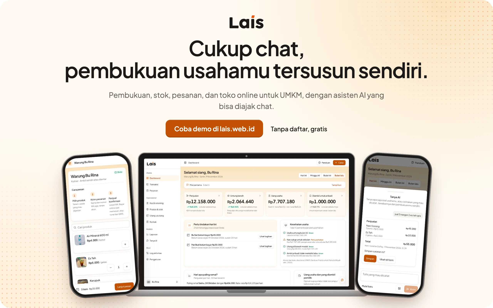
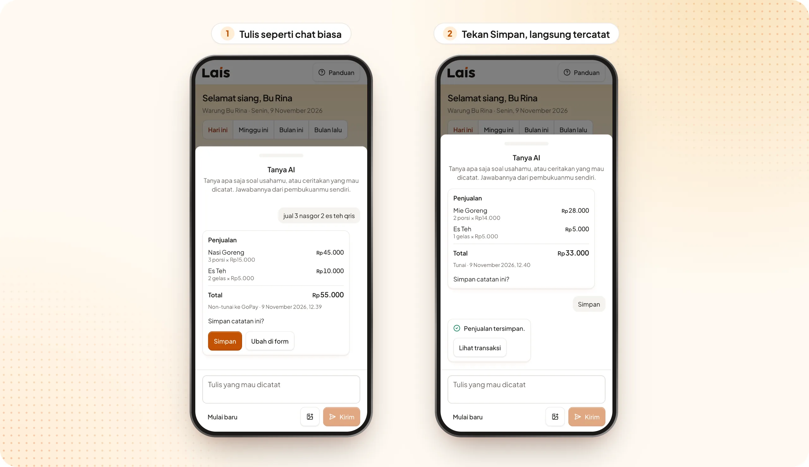
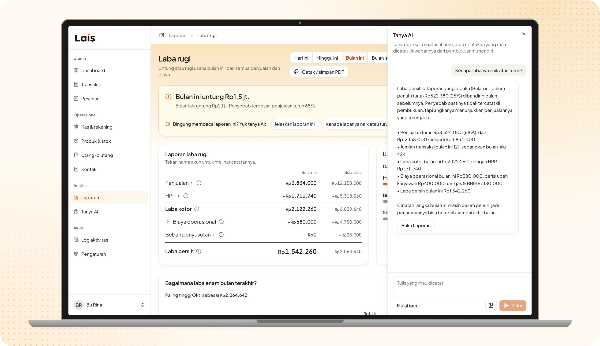
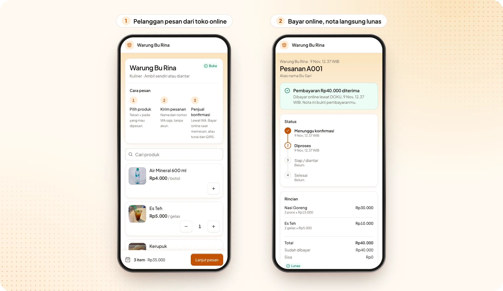
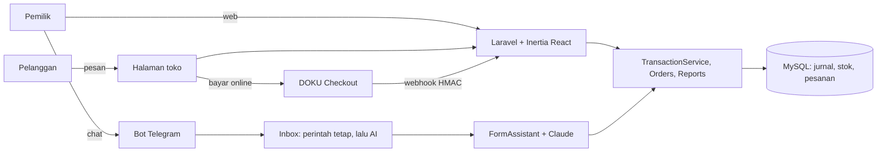

<p align="center">
  <a href="https://lais.web.id"></a>
</p>

<h3 align="center">Pembukuan, stok, pesanan, dan toko online untuk UMKM,<br>dengan asisten AI yang bisa diajak chat.</h3>

<p align="center">
  <a href="https://lais.web.id"></a>
  <a href="https://t.me/LaisHelpBot"></a>
  
  
  
  
</p>

> Banyak pemilik UMKM tidak mencatat keuangan karena pembukuan terasa rumit, dan aplikasinya terasa seperti software akuntan. Akibatnya laba tidak terlihat, uang usaha bercampur dengan uang pribadi, dan stok habis tanpa terasa. Lais memangkas usaha mencatat sampai sependek satu pesan chat, sementara pembukuan berpasangan (double-entry) yang benar tetap berjalan di belakangnya.

<p align="center">
  <a href="https://lais.web.id"><b>Coba demo tanpa daftar</b></a> &nbsp;·&nbsp; <a href="https://lais.web.id/t/warung-bu-rina">Lihat toko demo</a> &nbsp;·&nbsp; <a href="https://t.me/LaisHelpBot">Chat bot Lais di Telegram</a>
</p>

## Masalah dan pengguna sasaran

Pengguna utama Lais adalah pemilik UMKM berbasis produk: usaha yang memegang stok bahan atau barang dagangan, dijalankan sendiri atau dengan satu-dua pekerja, dan dikelola dari HP. Contohnya warung makan, toko kelontong, oleh-oleh, dan kerajinan.

Masalah yang mereka alami:

- **Mencatat terasa berat, jadi ditunda.** Pencatatan masih manual, atau tidak dilakukan sama sekali.
- **Uang usaha bercampur dengan uang pribadi.** Akibatnya laba sebenarnya tidak terlihat.
- **HPP dan stok tidak diketahui.** Harga jual ditentukan dari perkiraan, dan bahan habis tanpa terasa.
- **Laporan keuangan tidak siap.** Saat pemilik mengajukan pembiayaan, laporannya belum ada.

Kebutuhan ini kami temui langsung lewat pendampingan UMKM di Bali, salah satunya di program SMART UMKM Universitas Primakara. Kuliner (Warung Bu Rina) dipakai sebagai data demo karena alurnya paling lengkap, tetapi Lais tidak terbatas pada kuliner.

## Fitur unggulan

### 1. Catat cukup dengan chat

Tulis seperti bercerita: "jual 3 nasgor 2 es teh qris". Lais mengenali produknya, menghitung totalnya, lalu menunjukkan draf. Begitu kamu menekan Simpan, penjualan, stok, kas, dan jurnalnya tercatat sekaligus.

<p align="center">
  
</p>

- Lewat panel **Tanya AI** di web atau **bot Telegram**, dengan kalimat bebas maupun foto nota belanja.
- Draf selalu ditunjukkan dulu. Tidak ada yang tersimpan sebelum kamu menekan Simpan.
- Penjualan, belanja, biaya, utang-piutang, modal, dan pindah dana. Uang yang diambil untuk pribadi (prive) dipisah, jadi laba tetap jujur.

### 2. Laporan tersusun sendiri, dan bisa ditanya

Setiap catatan langsung masuk ke laporan keuangan yang mengacu pada SAK EMKM. Bingung membacanya? Tanya saja, dan jawabannya diambil dari pembukuanmu sendiri.

<p align="center">
  
</p>

- Laba rugi, posisi keuangan (neraca), perubahan modal, catatan atas laporan, buku kas, jurnal, buku besar, dan neraca saldo. Semuanya bisa dicetak atau disimpan sebagai PDF.
- Setiap laporan dibuka dengan kesimpulan satu kalimat, lalu pertanyaan siap pakai seperti "Kenapa labanya naik atau turun?".
- Tanya AI menjelaskan laporan yang sedang dibuka, mengartikan istilah seperti HPP, dan menilai apakah sebuah produk layak dijual.
- Dashboard merangkum penjualan, untung, kas, tagihan yang perlu ditindaklanjuti, dan kesehatan usaha.

### 3. Toko online, pesanan, dan bayar online

Setiap usaha langsung punya halaman toko sendiri. Pelanggan memesan tanpa akun, lalu membayar tunai, lewat QRIS toko, atau online.

<p align="center">
  
</p>

- Pesanan baru masuk ke web, bot Telegram, dan notifikasi HP. Pemilik menerima atau menolaknya dengan satu tombol.
- Bayar online lewat DOKU Checkout (sandbox). Nota pelanggan langsung berubah menjadi lunas.
- Stok ditahan selama pesanan berjalan, dan pesanan yang selesai otomatis menjadi penjualan di pembukuan.

## Yang juga ada

- **Stok dan HPP dari resep.** Ada produk biasa, bahan baku, dan produk dengan resep. Stok bahan berkurang sendiri, HPP dihitung dari harga bahan, dan ada peringatan stok menipis.
- **Utang-piutang** dengan sisa tagihan per kontak, dan tagihan lama yang muncul di dashboard.
- **Ringkasan harian** dari bot setiap pukul 21.00, atau kapan saja lewat `/ringkasan`.
- **Bisa dipasang di HP** (PWA), lengkap dengan halaman offline dan notifikasi pesanan baru.
- **Setup bertahap** untuk pemilik baru, dan tombol **Panduan** (tur interaktif) di setiap halaman utama.
- **Coba demo tanpa daftar.** Setiap pengunjung mendapat akun demo pribadi berisi data 90 hari Warung Bu Rina, yang terhapus otomatis setelah 48 jam.
- **Keamanan akun:** masuk dengan Google, verifikasi dua langkah, passkey, dan log aktivitas.

## AI yang bisa dipercaya

Angka keuangan tidak boleh dikarang, jadi pembagian kerjanya tegas:

- **Model hanya memilih.** Claude (Haiku 5.5) membaca kalimat pemilik lalu memilih satu tool: isi transaksi, tanya angka, jelaskan topik, artikan istilah, nilai produk, dan sebagainya.
- **Sistem yang menghitung dan menulis.** Angka diambil dari jurnal (`App\Services\Reports`, `ReportAnswers`). Saran pencatatan dan arti istilah berasal dari teks tetap (`App\Enums\GuideTopic`, `App\Enums\Term`). Penilaian produk memakai aturan tetap (`App\Enums\MarginLevel`).
- **Draf divalidasi oleh aturan yang sama dengan form web** (`FormRequest`), dan tidak ada yang tersimpan tanpa konfirmasi pemilik.
- **Jawaban bebas atas pertanyaan usaha** hanya boleh mengutip angka dari lembar fakta (`BusinessFacts::grounded()`).
- **Akurasi diukur dengan eval** terhadap model sungguhan (`tests/Feature/AssistantEvalTest.php`): intent dan isian dinilai per kasus, lalu diulang beberapa kali setiap kali prompt berubah.

## Teknologi dan arsitektur

| Bagian     | Teknologi                                                                                                                     |
| ---------- | ----------------------------------------------------------------------------------------------------------------------------- |
| Backend    | PHP 8.4, Laravel 13, MySQL, antrean database, penjadwal Laravel                                                               |
| Frontend   | React 19, Inertia 3, TypeScript, Tailwind CSS 4, komponen Radix UI                                                            |
| AI         | Claude Haiku 5.5 lewat Anthropic PHP SDK (`App\Services\Ai\LlmClient`)                                                        |
| Bot        | Telegram Bot API dengan long polling (`php artisan lais:telegram`). WhatsApp lewat GOWA tetap didukung (`BOT_CHANNEL`).       |
| Pembayaran | DOKU Checkout (sandbox), dengan webhook yang ditandatangani HMAC                                                              |
| File       | Cloudflare R2: bucket privat untuk bukti transaksi, bucket publik untuk foto produk dan QRIS                                  |
| Deploy     | Image Docker di Docker Hub, dijalankan Coolify. Supervisor menjalankan web, antrean, penjadwal, dan bot dalam satu container. |



Setiap usaha terisolasi. Semua data dibaca lewat usaha milik pengguna yang login, dan tes memastikan usaha lain tidak bisa dijangkau.

## Menjalankan di lokal

Yang dibutuhkan: PHP 8.4, Composer, Node.js 22, dan MySQL (atau SQLite untuk mencoba cepat).

```bash
composer setup          # install, salin .env, buat APP_KEY, migrasi
npm install
php artisan db:seed     # akun demo + 90 hari pembukuan Warung Bu Rina
php artisan dev         # server, antrean, log, dan Vite sekaligus
```

Buka http://localhost:8000 dan masuk dengan `demo@lais.test`. Kata sandinya diambil dari `DEMO_PASSWORD` (kalau kosong: `password`). Untuk akun demo pribadi, jalankan `php artisan lais:demo` sekali, lalu tekan **Coba demo tanpa daftar**.

**Variabel lingkungan** (lihat `.env.example`; isi nilainya sendiri dan jangan pernah di-commit):

| Kelompok        | Variabel                                                                                                                                        |
| --------------- | ----------------------------------------------------------------------------------------------------------------------------------------------- |
| Aplikasi        | `APP_URL`, `APP_TIMEZONE` (usaha di Bali: `Asia/Makassar`), `APP_LOCALE=id`, `DEMO_PASSWORD`                                                    |
| Database        | `DB_*`, `QUEUE_CONNECTION=database`, `DB_QUEUE_RETRY_AFTER`                                                                                     |
| AI              | `LLM_DRIVER=claude`, `ANTHROPIC_API_KEY`, `CLAUDE_MODEL`, `LLM_TIMEOUT`, `LLM_TIMEOUT_VISION`                                                   |
| Bot             | `BOT_CHANNEL=telegram`, `TELEGRAM_BOT_TOKEN`, `TELEGRAM_BOT_USERNAME`                                                                           |
| Notifikasi HP   | `VAPID_PUBLIC_KEY`, `VAPID_PRIVATE_KEY`, `VAPID_SUBJECT` (buat dengan `php artisan lais:vapid`; kosong berarti fitur ini tersembunyi)           |
| Pembayaran      | `DOKU_CLIENT_ID`, `DOKU_SECRET_KEY`, `DOKU_BASE_URL`                                                                                            |
| File (produksi) | `PROOF_DISK`, `MEDIA_DISK`, `R2_ACCESS_KEY_ID`, `R2_SECRET_ACCESS_KEY`, `R2_ENDPOINT`, `R2_PRIVATE_BUCKET`, `R2_PUBLIC_BUCKET`, `R2_PUBLIC_URL` |
| Login Google    | `GOOGLE_CLIENT_ID`, `GOOGLE_CLIENT_SECRET`, `GOOGLE_REDIRECT_URI`                                                                               |
| Email           | `MAIL_*` (dipakai untuk verifikasi email)                                                                                                       |

**Bot di lokal:** buat bot terpisah dari produksi lewat @BotFather, karena satu token hanya boleh dibaca satu poller. Isi `TELEGRAM_BOT_TOKEN` dan `TELEGRAM_BOT_USERNAME`, lalu jalankan `php artisan lais:telegram` di terminal lain.

## Pengujian

```bash
composer ci:check   # Pint, PHPStan, lint dan tipe frontend, seluruh tes PHPUnit
LLM_DRIVER=claude php artisan test --group=llm   # eval dengan Claude sungguhan (memakai kredit API)
```

Tes mencakup:

- jurnal yang selalu seimbang dan rekonsiliasi laba vs kas Rp0, termasuk ratusan transaksi acak
- stok, resep, dan pesanan
- webhook bertanda tangan (DOKU, GOWA)
- isolasi data antar usaha
- alur bot Telegram dan WhatsApp
- asisten AI dengan model tiruan

## Deployment dan akun demo

- **Aplikasi:** https://lais.web.id
- **Toko demo:** https://lais.web.id/t/warung-bu-rina
- **Bot Telegram:** https://t.me/LaisHelpBot

Untuk mencoba, tekan **Coba demo tanpa daftar** di halaman depan. Setiap pengunjung mendapat akun demo pribadi berisi data 90 hari Warung Bu Rina, yang terhapus otomatis setelah 48 jam. Kredensial akun demo tetap untuk juri dikirim lewat formulir panitia, tidak ditulis di repo ini.

## Batasan yang diketahui

- **SAK EMKM.** Pembukuan _mengacu_ pada SAK EMKM dan belum bisa disebut patuh penuh. Batasannya ditulis di catatan atas laporan, misalnya ongkos kirim pembelian dan utang bank.
- **Pembayaran online.** Bayar online masih DOKU Checkout mode sandbox dengan satu akun platform. Refund dilakukan manual dari dashboard DOKU, dan biaya DOKU dicatat pemilik sebagai beban.
- **Bot.** Bot sementara berjalan di Telegram, karena nomor bot WhatsApp lewat klien tidak resmi (GOWA) berisiko diblokir. Kode WhatsApp tetap ada dan bisa diaktifkan lagi lewat `BOT_CHANNEL`.
- **Cakupan.** Satu pemilik per usaha. Multi-outlet, banyak pengguna per usaha, payroll, dan UMKM jasa berbasis jadwal belum dicakup.
- **AI dan koneksi.** AI butuh koneksi internet, dan setiap usaha dibatasi 200 panggilan model per hari supaya biaya terkendali. Kalau AI tidak bisa dipakai, form manual tetap berjalan. Pencatatan offline belum tersedia; aplikasi yang dipasang di HP baru menampilkan halaman offline.

## Library open-source

Lais dibangun di atas library open-source berikut (dependensi langsung, versi dan lisensi dibaca dari `vendor/` dan `node_modules/`).

**PHP (Composer)**

| Library                    | Versi | Lisensi    |
| -------------------------- | ----- | ---------- |
| laravel/framework          | 13.37 | MIT        |
| inertiajs/inertia-laravel  | 3.5   | MIT        |
| laravel/fortify            | 1.41  | MIT        |
| laravel/socialite          | 5.31  | MIT        |
| laravel/wayfinder          | 0.1   | MIT        |
| laravel/tinker             | 3.0   | MIT        |
| laravel/chisel             | 0.1   | MIT        |
| spatie/laravel-activitylog | 5.1   | MIT        |
| league/flysystem-aws-s3-v3 | 3.35  | MIT        |
| anthropic-ai/sdk           | 1.6   | Apache-2.0 |
| minishlink/web-push        | 11.0  | MIT        |

**JavaScript (npm)**

| Library                                         | Versi         | Lisensi    |
| ----------------------------------------------- | ------------- | ---------- |
| react, react-dom                                | 19.3          | MIT        |
| @inertiajs/react, @inertiajs/vite               | 3.9           | MIT        |
| tailwindcss, @tailwindcss/vite                  | 4.3           | MIT        |
| radix-ui dan paket @radix-ui/\*                 | 1.x–2.x       | MIT        |
| @tanstack/react-table                           | 9.3           | MIT        |
| recharts                                        | 3.8           | MIT        |
| react-joyride                                   | 3.2           | MIT        |
| react-day-picker                                | 10.0          | MIT        |
| date-fns                                        | 4.4           | MIT        |
| sonner                                          | 2.0           | MIT        |
| vaul                                            | 1.1           | MIT        |
| cmdk                                            | 1.1           | MIT        |
| input-otp                                       | 1.5           | MIT        |
| lenis                                           | 1.3           | MIT        |
| clsx                                            | 2.1           | MIT        |
| tailwind-merge                                  | 3.7           | MIT        |
| tw-animate-css                                  | 1.4           | MIT        |
| class-variance-authority                        | 0.7           | Apache-2.0 |
| lucide-react                                    | 0.475         | ISC        |
| qrcode.react                                    | 4.2           | ISC        |
| @laravel/passkeys                               | 0.2           | MIT        |
| vite, @vitejs/plugin-react, laravel-vite-plugin | 8.3, 6.1, 3.2 | MIT        |
| typescript                                      | 5.9           | Apache-2.0 |
| concurrently                                    | 10.0          | MIT        |

Layanan pihak ketiga yang dipakai: Anthropic Claude API, Telegram Bot API, DOKU Checkout (sandbox), Cloudflare R2, dan Google Sign-In.

Proyek ini dimulai dari Laravel React Starter Kit (MIT). Font Plus Jakarta Sans memakai SIL Open Font License 1.1, dan foto usaha di landing page berasal dari Wikimedia Commons (CC BY-SA) dengan kredit di dekat setiap fotonya. Daftar lengkap teknologi, peran AI, dan alat bantu pengembangan ada di [AI & Technology Disclosure](docs/AI-DISCLOSURE.md).

## Tim

| Nama                               | Peran                                                                                    |
| ---------------------------------- | ---------------------------------------------------------------------------------------- |
| I Made Gautama                     | Pengembang: produk, desain antarmuka, kode, integrasi AI, dan deploy                     |
| Desak Putu Nitya Dewi, S.E., M.Si. | Akuntansi dan pendampingan UMKM: kebutuhan pengguna, aturan pembukuan SAK EMKM, validasi |

Keduanya dari Universitas Primakara.
