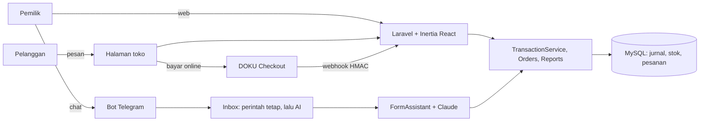

# Lais

Lais adalah sistem operasional untuk UMKM: pembukuan, stok, pesanan, dan toko online dalam satu tempat, dengan asisten AI yang bisa diajak chat. Pemilik cukup bercerita seperti "jual 3 nasi goreng qris", dan Lais yang menyusun catatannya. Stok, kas, dan laporan keuangan yang mengacu pada SAK EMKM ikut tersusun sendiri.

- **Aplikasi:** https://lais.web.id
- **Toko demo:** https://lais.web.id/t/warung-bu-rina
- **Bot Telegram:** [@LaisHelpBot](https://t.me/LaisHelpBot)
- **Akun demo:** `demo@lais.test`. Kata sandinya ada di formulir pengumpulan lomba.

## Masalah yang diselesaikan

Banyak pemilik UMKM tidak mencatat keuangan, karena pembukuan terasa rumit dan aplikasinya terasa seperti software akuntan. Akibatnya laba tidak terlihat, uang usaha bercampur dengan uang pribadi, dan stok habis tanpa terasa. Lais menurunkan usaha mencatat sampai sependek satu pesan chat, tanpa melepas pembukuan berpasangan (double-entry) yang benar di belakangnya.

Latar belakang, persona, dan kriteria keberhasilannya ada di [`docs/PRD.md`](docs/PRD.md).

## Fitur

**Mencatat**

- Catat penjualan, belanja, biaya, utang-piutang, modal, dan pindah dana. Bisa lewat form, kalimat bebas di panel Tanya AI, chat bot, atau foto nota belanja.
- Draf selalu ditunjukkan dulu, dan baru tersimpan setelah pemilik menekan Simpan.
- Uang usaha dan uang pribadi dipisah. Ambil untuk pribadi (prive) tidak mengurangi laba.

**Produk dan stok**

- Ada tiga jenis barang: produk biasa, bahan baku, dan produk dengan resep. Pada produk dengan resep, HPP dihitung dari harga bahannya.
- Stok berkurang dan bertambah sendiri dari setiap catatan. Ada koreksi stok dan peringatan stok menipis.

**Pesanan dan toko online**

- Setiap usaha punya halaman toko sendiri (`/t/{nama-toko}`). Pelanggan bisa memesan tanpa akun.
- Pemilik menerima, menyiapkan, dan menyelesaikan pesanan dari web atau bot. Pesanan yang selesai otomatis menjadi penjualan.
- Pembayaran bisa tunai, QRIS milik toko, atau bayar online lewat DOKU Checkout (sandbox).

**Laporan**

- Laba rugi, posisi keuangan (neraca), perubahan modal, catatan atas laporan, buku kas, produk terlaris, aset tetap dan penyusutan, daftar akun (COA), jurnal, buku besar, dan neraca saldo.
- Dashboard berisi ringkasan, kesehatan usaha, dan misi pertama untuk pemilik baru.

**Asisten AI (Tanya AI dan bot)**

- Mengubah kalimat atau foto nota menjadi draf catatan.
- Menjawab angka usaha (untung, kas, piutang, HPP), letak fitur ("utang dicatat di mana?"), arti istilah ("apa itu HPP?"), dan penilaian layak tidaknya produk ("es teh worth it?").

**Bot Telegram**

- Indikator "mengetik…", tombol Simpan dan Batal, tombol Terima dan Tolak untuk pesanan, dan panduan lewat `/start`.
- Ringkasan harian dikirim pukul 21.00, atau kapan saja lewat `/ringkasan`.

**Di HP**

- Lais bisa dipasang di layar utama HP (PWA) dari menu akun, menu **Lainnya**, atau landing page, lalu terbuka layar penuh seperti aplikasi.
- Tanpa sinyal, muncul halaman offline yang mengarahkan ke bot Telegram. Telegram menahan pesannya dan bot mencatatnya begitu HP online lagi.
- Notifikasi HP (web push) untuk pesanan baru dari toko online, diaktifkan per perangkat di Pengaturan → Bot. Di iPhone, Lais harus dipasang di layar utama dulu.

**Coba demo**

- Tombol **Coba demo tanpa daftar** di landing dan halaman login membuat akun demo pribadi berisi salinan data 90 hari Warung Bu Rina, tanpa perlu mendaftar. Setiap pengunjung mendapat akunnya sendiri, jadi data dan sambungan Telegram tidak saling bertabrakan.
- Tiga akun disiapkan lebih dulu oleh `php artisan lais:demo` (dijadwalkan tiap 5 menit), sehingga klik langsung masuk. Akun yang sudah diklaim terhapus otomatis bersama datanya setelah 48 jam.

**Panduan**

- Setup awal dibagi per langkah, termasuk langkah daftar akun.
- Setiap halaman utama punya tombol **Panduan** (tur interaktif), dan tur dashboard muncul sampai diselesaikan.

## AI yang bisa dipercaya

Angka keuangan tidak boleh dikarang, jadi pembagian kerjanya tegas:

- **Model hanya memilih.** Claude (Haiku 5.5) membaca kalimat pemilik lalu memilih satu tool: isi transaksi, tanya angka, jelaskan topik, artikan istilah, nilai produk, dan sebagainya.
- **Sistem yang menghitung dan menulis.** Angka diambil dari jurnal (`App\Services\Reports`, `ReportAnswers`). Saran pencatatan dan arti istilah berasal dari teks tetap (`App\Enums\GuideTopic`, `App\Enums\Term`). Penilaian produk memakai aturan tetap (`App\Enums\MarginLevel`).
- **Draf divalidasi oleh aturan yang sama dengan form web** (`FormRequest`), dan tidak ada yang tersimpan tanpa konfirmasi pemilik.
- **Jawaban bebas atas pertanyaan usaha** hanya boleh mengutip angka dari lembar fakta (`BusinessFacts::grounded()`).
- **Akurasi diukur dengan eval** terhadap model sungguhan (`tests/Feature/AssistantEvalTest.php`): intent dan isian dinilai per kasus, lalu diulang beberapa kali setiap kali prompt berubah.

## Teknologi dan arsitektur

| Bagian     | Teknologi                                                                                                                     |
| ---------- | ----------------------------------------------------------------------------------------------------------------------------- |
| Backend    | PHP 8.4, Laravel 13, MySQL, antrean database, penjadwal Laravel                                                               |
| Frontend   | React 19, Inertia 3, TypeScript, Tailwind CSS 4, komponen Radix UI                                                            |
| AI         | Claude Haiku 5.5 lewat Anthropic PHP SDK (`App\Services\Ai\LlmClient`)                                                        |
| Bot        | Telegram Bot API dengan long polling (`php artisan lais:telegram`). WhatsApp lewat GOWA tetap didukung (`BOT_CHANNEL`).       |
| Pembayaran | DOKU Checkout (sandbox), dengan webhook yang ditandatangani HMAC                                                              |
| File       | Cloudflare R2: bucket privat untuk bukti transaksi, bucket publik untuk foto produk dan QRIS                                  |
| Deploy     | Image Docker di Docker Hub, dijalankan Coolify. Supervisor menjalankan web, antrean, penjadwal, dan bot dalam satu container. |



Setiap usaha terisolasi. Semua data dibaca lewat usaha milik pengguna yang login, dan tes memastikan usaha lain tidak bisa dijangkau.

## Menjalankan di lokal

Yang dibutuhkan: PHP 8.4, Composer, Node.js 22, dan MySQL (atau SQLite untuk mencoba cepat).

```bash
composer setup          # install, salin .env, buat APP_KEY, migrasi
npm install
php artisan db:seed     # akun demo + 90 hari pembukuan Warung Bu Rina
php artisan dev         # server, antrean, log, dan Vite sekaligus
```

Buka http://localhost:8000 dan masuk dengan `demo@lais.test`. Kata sandinya diambil dari `DEMO_PASSWORD` (kalau kosong: `password`). Untuk akun demo pribadi, jalankan `php artisan lais:demo` sekali, lalu tekan **Coba demo tanpa daftar**.

**Variabel lingkungan** (lihat `.env.example`; isi nilainya sendiri dan jangan pernah di-commit):

| Kelompok        | Variabel                                                                                                                                        |
| --------------- | ----------------------------------------------------------------------------------------------------------------------------------------------- |
| Aplikasi        | `APP_URL`, `APP_TIMEZONE` (usaha di Bali: `Asia/Makassar`), `APP_LOCALE=id`, `DEMO_PASSWORD`                                                    |
| Database        | `DB_*`, `QUEUE_CONNECTION=database`, `DB_QUEUE_RETRY_AFTER`                                                                                     |
| AI              | `LLM_DRIVER=claude`, `ANTHROPIC_API_KEY`, `CLAUDE_MODEL`, `LLM_TIMEOUT`, `LLM_TIMEOUT_VISION`                                                   |
| Bot             | `BOT_CHANNEL=telegram`, `TELEGRAM_BOT_TOKEN`, `TELEGRAM_BOT_USERNAME`                                                                           |
| Notifikasi HP   | `VAPID_PUBLIC_KEY`, `VAPID_PRIVATE_KEY`, `VAPID_SUBJECT` (buat dengan `php artisan lais:vapid`; kosong berarti fitur ini tersembunyi)           |
| Pembayaran      | `DOKU_CLIENT_ID`, `DOKU_SECRET_KEY`, `DOKU_BASE_URL`                                                                                            |
| File (produksi) | `PROOF_DISK`, `MEDIA_DISK`, `R2_ACCESS_KEY_ID`, `R2_SECRET_ACCESS_KEY`, `R2_ENDPOINT`, `R2_PRIVATE_BUCKET`, `R2_PUBLIC_BUCKET`, `R2_PUBLIC_URL` |
| Login Google    | `GOOGLE_CLIENT_ID`, `GOOGLE_CLIENT_SECRET`, `GOOGLE_REDIRECT_URI`                                                                               |
| Email           | `MAIL_*` (dipakai untuk verifikasi email)                                                                                                       |

**Bot di lokal:** jalankan `php artisan lais:telegram` di terminal lain. Pakai bot terpisah dari produksi (buat lewat @BotFather), karena satu token hanya boleh dibaca satu poller. Detailnya ada di [`docs/TELEGRAM.md`](docs/TELEGRAM.md).

## Pengujian

```bash
composer ci:check   # Pint, PHPStan, lint dan tipe frontend, seluruh tes PHPUnit
LLM_DRIVER=claude php artisan test --group=llm   # eval dengan Claude sungguhan (memakai kredit API)
```

Tes mencakup:

- jurnal yang selalu seimbang dan rekonsiliasi laba vs kas Rp0, termasuk ratusan transaksi acak
- stok, resep, dan pesanan
- webhook bertanda tangan (DOKU, GOWA)
- isolasi data antar usaha
- alur bot Telegram dan WhatsApp
- asisten AI dengan model tiruan

## Dokumen

| Dokumen                                | Isi                                                                |
| -------------------------------------- | ------------------------------------------------------------------ |
| [`docs/PRD.md`](docs/PRD.md)           | Kebutuhan produk, user story, kriteria keberhasilan, aturan jurnal |
| [`docs/UI-PAGES.md`](docs/UI-PAGES.md) | Spesifikasi tiap halaman                                           |
| [`docs/DESIGN.md`](docs/DESIGN.md)     | Sistem desain: token, komponen, aturan tampilan                    |
| [`docs/TELEGRAM.md`](docs/TELEGRAM.md) | Menyalakan dan memakai bot Telegram                                |
| [`docs/WHATSAPP.md`](docs/WHATSAPP.md) | Bot lewat WhatsApp (GOWA) dan skenario demo                        |

## Library open-source

Lais dibangun di atas library open-source berikut (dependensi langsung, versi dan lisensi dibaca dari `vendor/` dan `node_modules/`).

**PHP (Composer)**

| Library                    | Versi | Lisensi    |
| -------------------------- | ----- | ---------- |
| laravel/framework          | 13.37 | MIT        |
| inertiajs/inertia-laravel  | 3.5   | MIT        |
| laravel/fortify            | 1.41  | MIT        |
| laravel/socialite          | 5.31  | MIT        |
| laravel/wayfinder          | 0.1   | MIT        |
| laravel/tinker             | 3.0   | MIT        |
| laravel/chisel             | 0.1   | MIT        |
| spatie/laravel-activitylog | 5.1   | MIT        |
| league/flysystem-aws-s3-v3 | 3.35  | MIT        |
| anthropic-ai/sdk           | 1.6   | Apache-2.0 |
| minishlink/web-push        | 11.0  | MIT        |

**JavaScript (npm)**

| Library                                         | Versi         | Lisensi    |
| ----------------------------------------------- | ------------- | ---------- |
| react, react-dom                                | 19.3          | MIT        |
| @inertiajs/react, @inertiajs/vite               | 3.9           | MIT        |
| tailwindcss, @tailwindcss/vite                  | 4.3           | MIT        |
| radix-ui dan paket @radix-ui/*                  | 1.x–2.x       | MIT        |
| @tanstack/react-table                           | 9.3           | MIT        |
| recharts                                        | 3.8           | MIT        |
| react-joyride                                   | 3.2           | MIT        |
| react-day-picker                                | 10.0          | MIT        |
| date-fns                                        | 4.4           | MIT        |
| sonner                                          | 2.0           | MIT        |
| vaul                                            | 1.1           | MIT        |
| cmdk                                            | 1.1           | MIT        |
| input-otp                                       | 1.5           | MIT        |
| lenis                                           | 1.3           | MIT        |
| clsx                                            | 2.1           | MIT        |
| tailwind-merge                                  | 3.7           | MIT        |
| tw-animate-css                                  | 1.4           | MIT        |
| class-variance-authority                        | 0.7           | Apache-2.0 |
| lucide-react                                    | 0.475         | ISC        |
| qrcode.react                                    | 4.2           | ISC        |
| @laravel/passkeys                               | 0.2           | MIT        |
| vite, @vitejs/plugin-react, laravel-vite-plugin | 8.3, 6.1, 3.2 | MIT        |
| typescript                                      | 5.9           | Apache-2.0 |
| concurrently                                    | 10.0          | MIT        |

Layanan pihak ketiga yang dipakai: Anthropic Claude API, Telegram Bot API, DOKU Checkout (sandbox), Cloudflare R2, dan Google Sign-In.
