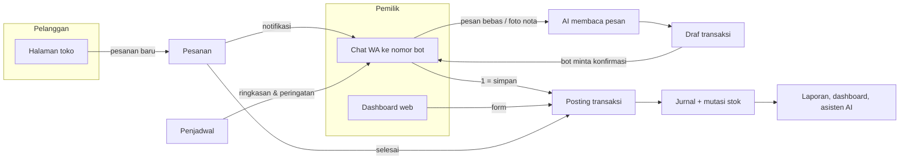
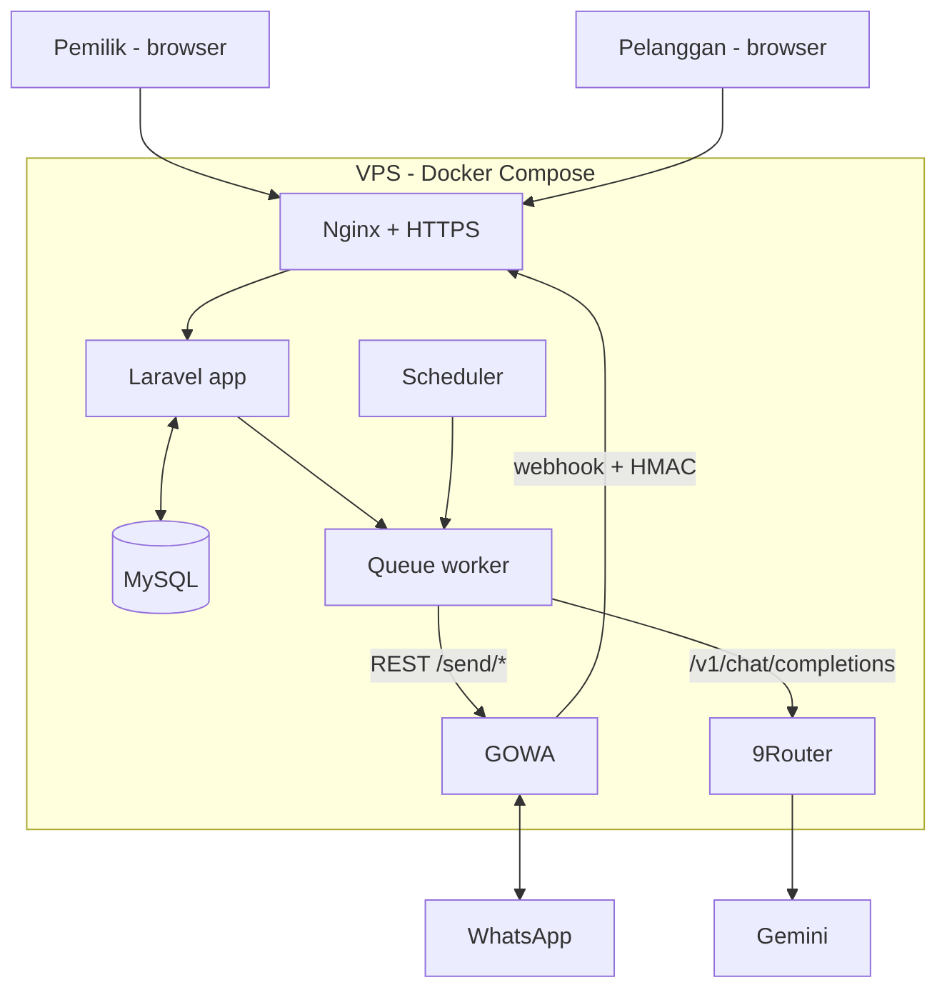

# PRD: Sistem Operasional UMKM via Web + WhatsApp

|                    |                                                                                                                                               |
| ------------------ | --------------------------------------------------------------------------------------------------------------------------------------------- |
| **Nama produk**    | TBD                                                                                                                                           |
| **Konteks**        | GTNIC 2026, kategori Web Development. Sub-tema "Accelerating Digital Transformation for Business and SMEs", fokus UMKM & Ekonomi Digital      |
| **Status**         | Draf v0.2, 14 Oktober 2026. Detail teknis dicek ke dokumentasi terbaru via Context7 (Laravel 13.x, Laravel AI SDK, GOWA, 9Router, Gemini API) |
| **Tim pengembang** | 1 developer                                                                                                                                   |
| **Batas waktu**    | Pengerjaan 19 Okt – 10 Nov 2026, submit 10 Nov 23.59 WIB, final (Zoom) 14 Nov                                                                 |

---

## 1. Executive Summary

### Problem Statement

Pemilik UMKM produk mengerjakan semua peran sendiri: jualan, belanja, produksi, sekaligus pembukuan. Akibatnya uang usaha dan pribadi bercampur (baru 46% UMKM yang memisahkannya), stok dan HPP tidak terpantau, dan pemilik tidak tahu laba sebenarnya. Aplikasi pembukuan yang ada menuntut waktu input yang tidak mereka punya.

### Proposed Solution

Sistem operasional berbasis web yang bisa diisi lewat chat WhatsApp berbahasa sehari-hari. Dari pesan seperti "jual 3 nasgor 2 es teh qris", sistem mencatat penjualan, mengurangi stok bahan sesuai resep, menghitung HPP, memisahkan uang pribadi, dan menyusun laporan sesuai SAK EMKM. Pelanggan bisa memesan lewat halaman toko di web, dan asisten AI menjelaskan laporan dengan bahasa biasa.

### Success Criteria

| #   | KPI                                             | Target                                                                                                                                         | Cara ukur                                                                                             |
| --- | ----------------------------------------------- | ---------------------------------------------------------------------------------------------------------------------------------------------- | ----------------------------------------------------------------------------------------------------- |
| K1  | Alur demo berjalan end-to-end di hosting publik | 4 dari 4 skenario demo (lihat §2.6) lolos tanpa mengubah database secara manual                                                                | Checklist uji manual sebelum rekam video                                                              |
| K2  | Akurasi pembacaan pesan WA                      | Intent benar ≥ 95%, field benar (produk, qty, harga, metode bayar) ≥ 90%                                                                       | Set uji 60 pesan (§3.2)                                                                               |
| K3  | Integritas akuntansi                            | 100% jurnal seimbang (debit = kredit). Neraca seimbang di 100% skenario uji, termasuk 500 transaksi acak. Rekonsiliasi laba vs kas selisih Rp0 | Test otomatis Pest                                                                                    |
| K4  | Grounding asisten AI                            | 0 angka karangan, artinya setiap angka di jawaban berasal dari output fungsi. Pemilihan fungsi benar ≥ 90%                                     | Set uji 30 pertanyaan (§3.2)                                                                          |
| K5  | Waktu mencatat lewat WA                         | Median ≤ 30 detik dari pesan dikirim sampai tersimpan. Balasan bot p90 ≤ 8 detik                                                               | Log `ai_logs` + uji ke ≥ 3 pemilik UMKM; ≥ 2 dari 3 berhasil mencatat transaksi pertama tanpa dibantu |

### Pemetaan ke rubrik lomba

| Kriteria (bobot)                 | Jawaban produk                                                                                                 |
| -------------------------------- | -------------------------------------------------------------------------------------------------------------- |
| Relevansi Masalah (20%)          | Masalah divalidasi data (BPS, OCBC/NielsenIQ, BI), masukan dosen, dan buku akuntansi UMKM (Alliyah dkk., 2025) |
| Fungsionalitas (25%)             | 8 modul MVP berjalan di tiga saluran: WA, dashboard web, halaman toko                                          |
| Kualitas Teknis & Keamanan (20%) | Jurnal double-entry otomatis, test otomatis, webhook HMAC, isolasi data per usaha, AI hanya memilih fungsi     |
| UX (15%)                         | Input bahasa bebas, konfirmasi sebelum simpan, responsif mulai lebar 360 px                                    |
| Dampak & Skalabilitas (10%)      | Dua mode produk (biasa dan berkomposisi) sehingga berlaku di luar kuliner; arsitektur multi-usaha              |
| Dokumentasi & Demo (10%)         | PRD ini, README, video 3–5 menit dengan alur §2.6                                                              |

---

## 2. User Experience & Functionality

### 2.1 User Personas

**P1. Bu Rina, pemilik warung nasi goreng dan katering rumahan (persona utama dan kasus demo)**

- Usia 38 tahun, dibantu 1 karyawan. Omzet sekitar Rp15 jt/bulan.
- Terima pesanan lewat WA pribadi, menerima tunai dan QRIS statis.
- Belanja bahan dari uang yang sama dengan uang dapur. Tidak tahu untung per porsi.
- Nyaman memakai WhatsApp, jarang membuka aplikasi lain. Mencatat di buku tulis kalau sempat.

**P2. Pak Dedi, pemilik toko kelontong / toko baju kecil (persona skalabilitas)**

- Menjual barang jadi, jadi tidak ada resep. Memakai mode produk biasa.
- Masalah utamanya stok yang tidak sinkron dan pembeli yang berutang.

**P3. Pelanggan**

- Ingin memesan tanpa harus chat bolak-balik, tahu total harga, dan tahu status pesanannya.
- Tidak perlu membuat akun.

### 2.2 Alur Pengguna Utama



Contoh percakapan pencatatan:

```
Pemilik : jual 3 nasgor 2 es teh qris
Bot     : Cek dulu ya:
          Penjualan (QRIS)
          • 3 × Nasi Goreng @Rp15.000 = Rp45.000
          • 2 × Es Teh @Rp5.000 = Rp10.000
          Total Rp55.000
          Balas 1 = simpan, 2 = batal, atau ketik koreksinya.
Pemilik : 1
Bot     : Tersimpan. Stok telur tinggal 6 butir (batas minimum 10).
```

### 2.3 User Stories & Acceptance Criteria

#### M0. Akun & Onboarding

**US-01.** Sebagai pemilik, saya ingin mendaftar dan menyiapkan usaha dalam satu alur, supaya bisa langsung mencatat.

- Daftar memakai nama, nomor WA, dan password. Login memakai nomor WA dan password, tanpa email.
- Nomor WA diverifikasi lewat OTP 6 digit yang dikirim bot. OTP berlaku 5 menit, maksimal 3 permintaan per 15 menit.
- Wizard onboarding berisi:
    - profil usaha: nama, jenis usaha, dan tanggal mulai pembukuan
    - saldo awal tiap rekening (bisa menambah rekening)
    - peralatan (nama dan nilai)
    - produk dan bahan dengan stok awal, dengan tombol "Pakai contoh" per jenis usaha
    - utang awal ke supplier dan piutang awal pelanggan (opsional)
    - ringkasan neraca awal

    Slug toko, logo, dan gambar QRIS ditambahkan ke wizard bersama halaman toko (M4), dan kartu "Hubungkan WhatsApp" bersama GOWA.

- Wizard bisa dilewati. Drafnya tersimpan setiap langkah, dan dashboard serta Kas & rekening menampilkan pengingat sampai wizard selesai. Tanggal mulai paling lambat hari catatan pertama yang sudah ada.
- Sistem membuat jurnal saldo awal. Modal awal = total aset awal − utang awal, dan neraca hari pertama langsung seimbang.
- Pemilik baru bisa menyelesaikan onboarding dengan 5 produk dalam ≤ 10 menit (uji ke 3 orang).
- Reset password memakai OTP WA, jadi tidak perlu SMTP.
- **Penyesuaian (4 Nov 2026):** login tetap memakai email dari starter kit. Nomor WA dihubungkan di Pengaturan > WhatsApp dengan cara **pemilik mengirim kode `LAIS ######` ke bot** dari WA-nya sendiri. Ini membuktikan kepemilikan nomor seperti OTP, sekaligus menyimpan LID pengirim (risiko `…@lid` di §Risiko). Daftar, login, dan reset password lewat nomor WA belum dibuat.

#### M1. Produk & Stok

**US-02.** Sebagai pemilik, saya ingin mendaftarkan produk dengan dua mode, supaya stok dan HPP terhitung sesuai jenis usaha saya.

- Setiap item punya atribut: nama, alias (misalnya "nasgor"), satuan, harga jual, stok minimum, `dijual` (ya/tidak), `tampil_di_toko`, dan foto.
- Tiga jenis item:
    - **Produk biasa:** dijual dan punya stok sendiri.
    - **Bahan baku:** punya stok, tidak dijual.
    - **Produk berkomposisi:** dijual, tidak punya stok sendiri, punya resep (daftar bahan dan jumlahnya).
- Biaya per unit memakai metode rata-rata tertimbang (moving average) yang diperbarui setiap pembelian. Rumusnya `(stok_lama × biaya_lama + qty_beli × harga_beli) / (stok_lama + qty_beli)`. Jika stok lama ≤ 0, biaya baru = harga beli.
- HPP produk berkomposisi = Σ (qty resep × biaya rata-rata bahan), dan tampil di halaman produk bersama margin (Rp dan %).
- Satu item hanya punya satu satuan di MVP. Konversi satuan masuk v1.1.

**US-03.** Sebagai pemilik, saya ingin stok berkurang otomatis saat terjual, supaya tidak perlu menghitung manual.

- Penjualan produk biasa mengurangi stok produk itu. Penjualan produk berkomposisi mengurangi stok setiap bahan sesuai resep × qty.
- Stok boleh minus, karena penjualan tidak boleh diblokir. Item minus diberi tanda di dashboard dengan saran "catat pembelian atau koreksi stok".
- Setiap perubahan stok tercatat di `stock_movements` beserta sumber transaksinya.

**US-04.** Sebagai pemilik, saya ingin mengoreksi stok hasil hitung fisik, supaya data sesuai kenyataan.

- Pemilik mengisi stok fisik. Selisihnya dijurnal ke akun Selisih Persediaan (beban atau pengurang beban).
- Riwayat koreksi bisa dilihat per item.

#### M2. Pencatatan Transaksi

**US-05.** Sebagai pemilik, saya ingin mencatat lima jenis transaksi lewat form web, supaya semua kegiatan usaha tercatat.

- Kategori mengikuti Bab 4 buku acuan: **Penjualan**, **Pembelian** (bahan, barang dagang, peralatan), **Biaya Operasional**, **Utang-Piutang** (bayar utang, terima piutang), dan **Modal** (setor, ambil pribadi). Ditambah **Pindah dana** antar rekening (setor tunai ke bank, tarik tunai, antar rekening), yang tidak mengubah jumlah uang usaha. Ada juga **Saldo awal** yang dicatat saat mulai: kas per rekening, peralatan, utang ke supplier, dan piutang pelanggan. Modal Pemilik menampung selisihnya, sehingga laporan perubahan modal bisa memisahkan modal awal dari setoran. Saldo awal tidak dihitung sebagai uang masuk.
- Subkategori biaya operasional: listrik & air, gas & bahan bakar, sewa, upah karyawan, transportasi & ongkir, pemasaran, lain-lain.
- Metode bayar:
    - tunai (masuk Kas tunai)
    - non-tunai (QRIS/transfer, ke rekening yang dipilih; pilihan baru muncul kalau rekening non-tunainya lebih dari satu)
    - kredit (belum dibayar)
    - uang pribadi (khusus pembelian dan biaya)
- Setiap transaksi yang disimpan menghasilkan jurnal sesuai tabel §4.4, dalam satu transaksi database (atomic).
- Transaksi tidak pernah dihapus. "Batalkan" membuat jurnal pembalik dan mutasi stok pembalik. "Ubah" berarti batalkan lalu buat ulang. Riwayatnya tetap terlihat.
- Bukti transaksi (foto) bisa dilampirkan: jpg/png/webp, maksimal 5 MB.
    - Status (4 Nov 2026): sudah ada di form Catat transaksi (semua jenis), di dialog bayar Pesanan dan Utang-piutang (saat Transfer/QRIS), dan foto nota dari Tanya AI ikut tersimpan saat drafnya disimpan.
    - Satu foto per transaksi, disimpan di disk privat dan hanya dibuka lewat rute yang mewajibkan login pemilik (lebih ketat dari signed route di §Keamanan, karena link bertanda tangan bisa diteruskan ke orang lain). File tidak pernah dihapus; "Ubah" membawa bukti ke versi baru.

**US-06.** Sebagai pemilik, saya ingin mencatat lewat chat WA dengan bahasa sehari-hari, supaya pencatatan tidak menyita waktu.

- Bot memahami angka informal: "15rb", "15k", "1,5jt", "ceban", "goceng".
- Satu pesan bisa berisi beberapa item. Satu pesan menghasilkan satu draf transaksi.
- Nama produk dicocokkan ke nama dan alias. Jika tidak ada yang cocok, bot menawarkan maksimal 3 kandidat terdekat atau opsi "buat produk baru".
- Jika harga tidak disebut, sistem memakai harga jual terdaftar. Jika harga disebut dan berbeda, sistem memakai harga yang disebut dan menandainya di konfirmasi.
- Jika metode bayar tidak disebut, defaultnya tunai, dan ini terlihat di konfirmasi.
- Bot **selalu** meminta konfirmasi sebelum menyimpan. Balasan "1" (simpan) dan "2" (batal) diproses tanpa LLM. Balasan lain dianggap koreksi lalu dibaca ulang.
- Draf kedaluwarsa setelah 15 menit. Satu pemilik hanya punya satu draf aktif. Pesan transaksi baru menggantikan draf lama, dan bot memberi tahu bahwa draf lama dibatalkan.
- Setelah tersimpan, bot menyebut efek pentingnya, misalnya stok yang jatuh di bawah minimum.
- Pesan dari nomor tidak terdaftar dibalas sekali per 24 jam dengan link pendaftaran. Pesan grup diabaikan.
- **Status (4 Nov 2026):** sudah jalan lewat GOWA (`App\Services\WhatsApp\Inbox`), memakai `FormAssistant` yang sama dengan Tanya AI web, termasuk foto nota. "1"/"2" tanpa LLM, draf 15 menit di cache, riwayat hanya 15 menit terakhir. Sumber transaksi `wa`. Cara memasang: `docs/WHATSAPP.md`.
- **Keputusan sementara (6 Nov 2026):** bot berjalan di Telegram (Bot API resmi) karena nomor bot lewat GOWA berisiko diblokir. Perilaku bot tetap sama dan semua kata "WhatsApp" di alur bot berlaku juga untuk Telegram. Sumber transaksinya `tg`. Saklarnya `BOT_CHANNEL`, dan GOWA tetap bisa dipakai lagi. Kabar ke pelanggan tetap link `wa.me` dari WA pemilik. Cara memasang: `docs/TELEGRAM.md`.

#### M3. Dua Dompet (Uang Usaha vs Pribadi)

**US-07.** Sebagai pemilik, saya ingin pengambilan uang untuk keperluan pribadi tercatat terpisah, supaya laba usaha tidak tercampur.

- "ambil 200rb buat rumah" dicatat sebagai Prive dan mengurangi kas usaha. Prive tidak masuk biaya dan tidak mengurangi laba.
- "setor 1jt" atau "tambah modal 1jt" dicatat sebagai setoran modal.
- Pembelian atau biaya yang dibayar pakai uang pribadi ("beli gas 25rb pakai uang sendiri") otomatis tercatat sebagai setoran modal, jadi kas usaha tidak berubah tetapi biayanya tetap tercatat.
- Dashboard menampilkan saldo kas usaha (tunai + non-tunai) dan total diambil pribadi bulan ini, berdampingan.
- **Kas & rekening:** uang usaha dirinci per tempatnya, yaitu satu Kas tunai dan satu atau lebih rekening non-tunai (BCA, GoPay, dan seterusnya).
    - Rekening dikelola pemilik: tambah, ganti nama, dan arsipkan saat saldonya Rp0.
    - Saldo tiap rekening dihitung dari jurnal.
    - Bagan akun tetap; rekening adalah rincian di bawah 1101/1102.

#### M4. Pesanan & Halaman Toko

**US-08.** Sebagai pelanggan, saya ingin memesan lewat halaman toko, supaya tidak perlu chat bolak-balik.

- URL publik `/t/{slug}` menampilkan nama toko, katalog (item dengan `dijual` dan `tampil_di_toko` aktif), harga, dan foto.
- Produk biasa dengan stok ≤ 0 tampil "Habis" dan tidak bisa dipesan. Produk berkomposisi memakai saklar "tersedia" yang diatur pemilik.
- Form pesanan berisi nama, nomor WA (format 08… atau 62…), ambil sendiri atau diantar (alamat wajib jika diantar), waktu, dan catatan. Tidak perlu membuat akun.
- Ada catatan privasi singkat di form: data hanya dipakai untuk pesanan ini.
- Setelah mengirim, pelanggan diarahkan ke halaman status `/p/{token}`. Token acak 32 karakter, bukan ID berurutan.
- Form dibatasi 5 pesanan per IP per 10 menit dan maksimal 20 baris item, dengan honeypot anti-bot.

**US-09.** Sebagai pemilik, saya ingin menerima dan mengelola pesanan dari WA, supaya tidak perlu membuka web.

- Setiap pesanan baru memicu notifikasi WA berisi kode pesanan (misalnya A012), nama, item, total, dan waktu.
- Pemilik bisa membalas "terima A012", "tolak A012", "A012 selesai", atau "A012 lunas". Semua aksi yang sama juga ada di web.
- Status pesanan: Menunggu konfirmasi → Diproses → Siap/Diantar → Selesai, atau Ditolak.
- Status bayar: Belum bayar → DP → Lunas. DP dan pelunasan dicatat dengan nominal dan metode.
- Setiap perubahan status, bot mengirim link `wa.me` dengan pesan yang sudah terisi (termasuk link nota) untuk diteruskan pemilik dari WA-nya sendiri. Bot tidak pernah mengirim pesan langsung ke pelanggan.
- **Status (4 Nov 2026):** notifikasi pesanan baru dan perintah `terima`, `tolak`, `siap`, `selesai`, `batal`, `dp <nominal> [qris]`, dan `lunas [qris]` sudah jalan tanpa LLM. Teks kabar ke pelanggan satu sumber di `App\Support\OrderMessages`, dipakai web dan bot.

**US-10.** Sebagai pelanggan, saya ingin melihat nota dan status pesanan, supaya tahu apa yang harus dibayar dan kapan pesanan siap.

- Halaman `/p/{token}` menampilkan timeline status, item, total, sudah dibayar, sisa, gambar QRIS toko beserta petunjuk bayar, dan tombol "Hubungi penjual" (`wa.me` ke nomor pemilik).
- Halaman ini sekaligus menjadi nota digital dan bisa dicetak atau disimpan sebagai PDF dari browser.

**Aturan akuntansi pesanan:**

- DP sebelum pesanan selesai dicatat sebagai Uang Muka Pesanan (kewajiban).
- Saat pesanan Selesai, penjualan diakui dan stok berkurang. Uang muka dipindahkan ke penjualan, dan sisa yang belum dibayar menjadi piutang.
- Pembayaran setelah Selesai dicatat sebagai terima piutang, paling banyak sebesar sisanya.
- Pesanan yang sudah diterima tidak ditolak, tetapi **dibatalkan** (status akhir tetap Ditolak, dengan alasan). Uang mukanya dibatalkan lewat jurnal cermin, artinya uang dikembalikan ke pelanggan.
- Transaksi yang dibuat pesanan hanya bisa diubah atau dibatalkan dari halaman pesanannya.

**Status pengerjaan (web, 4 Nov 2026):** halaman toko, checkout, nota, daftar dan detail pesanan, pesanan manual oleh pemilik, upload QRIS, foto produk, dan QR toko untuk dicetak sudah jadi. Notifikasi dan perintah lewat WA (US-09) menunggu GOWA; sementara pesanan baru tampil sebagai angka di menu Pesanan dan aksi di dashboard, dan kabar ke pelanggan dikirim dari tombol `wa.me` di detail pesanan.

**Penyimpangan dari §Keamanan:** foto produk dan QRIS disimpan di disk publik, bukan disk privat dengan signed route, karena keduanya memang untuk dilihat pelanggan tanpa login.

#### M5. Utang-Piutang

**US-11.** Sebagai pemilik, saya ingin melihat siapa yang belum bayar dan ke siapa saya berutang, supaya tagihan tidak terlupa.

- Piutang otomatis terbentuk dari penjualan atau pesanan selesai yang belum lunas. Utang otomatis terbentuk dari pembelian dengan metode kredit.
- Daftar berisi kontak, nominal, sisa, tanggal, dan umur (hari).
- Pembayaran sebagian didukung. Lunas otomatis jika sisa = 0.
- Lewat WA: "bu sari bayar 50rb" tercatat sebagai penerimaan piutang setelah konfirmasi.
- Pembayaran melunasi tagihan paling lama lebih dulu. Pembayaran yang dicatat dari halaman pesanan melunasi pesanan itu dulu. Jadi status bayar pesanan tetap benar dari mana pun pembayarannya dicatat.

**Status pengerjaan (web, 4 Nov 2026):** halaman Utang-piutang (tab Piutang/Utang, ringkasan, umur tagihan, catat pembayaran, tombol Ingatkan lewat `wa.me`) dan rincian per kontak sudah jadi. Pencatatan lewat WA menunggu GOWA.

#### M6. Laporan & Dashboard

**US-12.** Sebagai pemilik, saya ingin melihat laporan keuangan standar, supaya tahu kondisi usaha dan siap jika mengajukan pinjaman.

- **Laba Rugi:** penjualan − HPP = laba kotor, − biaya operasional per subkategori − selisih persediaan = laba bersih.
- **Buku Kas:** mutasi kas tunai dan non-tunai dengan saldo berjalan.
- **Neraca:** aset (kas tunai, kas non-tunai, piutang, persediaan, peralatan) = kewajiban (utang usaha, uang muka pesanan) + ekuitas (modal, prive, laba). Wajib selalu seimbang, dan ada indikator "Seimbang ✓" di layar.
- **Perubahan Modal:** modal awal periode + setoran + laba bersih − prive = modal akhir. Juga tampil sebagai kartu di dashboard.
- **Utang-Piutang** (dari M5), **Produk Terlaris** (urut qty dan laba), dan **Margin per Produk**.
- Filter periode: hari ini, minggu ini, bulan ini, bulan lalu, atau rentang tanggal.
- Ekspor PDF untuk Laba Rugi, Neraca, Buku Kas, Perubahan Modal, dan Utang-Piutang. Header PDF berisi nama usaha, periode, dan tanggal cetak.
- Laporan untuk data 1 tahun (±10.000 transaksi) tampil dalam ≤ 1 detik di server.
- **Status slice 8 (3 Nov 2026):**
    - Sudah jadi: Pusat laporan, Laba rugi (biaya per jenis), Perubahan modal dengan kartu **Laba vs Kas** (rekonsiliasi untuk skenario demo 4), dan Neraca per tanggal dengan badge Seimbang.
    - Semua angka dihitung di `App\Services\Reports` dari jurnal. Uji acak `LedgerTest` memeriksa bahwa neraca seimbang, laba vs kas selisih Rp0, dan perubahan modal cocok (K3).
    - Filter periode bertambah **Bulan lalu**. Rentang tanggal menyusul di slice 11.
    - PDF untuk sementara lewat **cetak dari browser** ("Cetak / simpan PDF"), dengan header nama usaha, periode, dan tanggal cetak. PDF dari server (dompdf) menyusul untuk "kirim laporan pdf" lewat WA.
    - Buku kas dan Produk terlaris masih "Segera".
- **Status slice 11 (7 Nov 2026):**
    - Filter **rentang tanggal** sudah ada di semua laporan berperiode, dan tiap laporan dibuka dengan kesimpulan yang dihitung server dari jurnal, tanpa AI.
    - Acuan akuntansi: SAK EMKM. Sumber yang dibaca adalah draf eksposur IAI; IAI menyatakan SAK EMKM disahkan 24 Oktober 2016 dan belum direvisi. Nomor paragraf perlu dicocokkan dengan teks final sebelum dikutip di proposal.
    - Laporan minimum SAK EMKM (par. 3.9) sudah lengkap: Laporan Posisi Keuangan, Laba Rugi, dan Catatan atas Laporan Keuangan otomatis di `/laporan/catatan`. Keduanya memakai kolom pembanding periode sebelumnya (par. 3.8).
    - Lais hanya boleh menyebut "mengacu pada SAK EMKM", bukan "patuh" (par. 3.4), karena ongkir pembelian belum masuk biaya perolehan persediaan (par. 9.3) dan utang bank belum didukung.
    - Penyusutan peralatan dibuat: garis lurus tanpa nilai residu, per bulan penuh mulai bulan perolehan, akun 1402 dan 6301, jurnal lewat `lais:penyusutan`. Peralatan lama menunggu pemilik mengisi umur pakainya, jadi pembukuan lama tidak berubah sendiri.
    - Baru: Daftar akun (COA), Buku besar, Neraca saldo, Aset tetap, Buku kas, Produk terlaris dan margin (termasuk barang jarang laku).
    - Pemilik bisa menambah akun Beban dan Pendapatan sendiri. Akun sistem dan kategori terkunci. Jenis transaksi baru: Pemasukan lain.

**US-13.** Sebagai pemilik, saya ingin dashboard yang langsung menunjukkan kondisi hari ini.

- Kartu: penjualan hari ini dan bulan ini, laba bersih bulan ini, saldo kas usaha, diambil pribadi bulan ini, piutang, utang, pesanan aktif.
- Grafik penjualan 30 hari, daftar stok menipis, kartu perubahan modal, dan kartu kesehatan usaha (§M8).

#### M7. Asisten AI

**US-14.** Sebagai pemilik, saya ingin bertanya soal usaha saya dengan bahasa biasa, di WA maupun web, supaya tidak perlu membaca laporan sendiri.

- Contoh pertanyaan yang harus terjawab: "untung bulan ini berapa?", "produk apa paling laku minggu ini?", "kenapa laba naik tapi kas turun?", "siapa yang belum bayar?", "telur cukup buat berapa hari?".
- AI hanya boleh memanggil fungsi baca yang sudah disediakan (§3.1). AI tidak menulis SQL, tidak menghitung angka sendiri, dan tidak bisa mengubah data.
- Di web, setiap jawaban mencantumkan sumber datanya, misalnya "Sumber: laba_rugi(bulan_ini)".
- Pertanyaan di luar urusan usaha ditolak dengan sopan dan diarahkan ke contoh pertanyaan yang didukung.
- Permintaan "kirim laporan bulan ini pdf" di WA dibalas dengan file PDF (memakai M6).

**US-14a (sprint web, 27 Okt 2026).** Sebagai pemilik, saya ingin menceritakan transaksi atau produk baru dengan bahasa biasa di web, lalu cukup mengonfirmasi ringkasannya, supaya tidak bingung field mana yang harus diisi.

- Panel "Tanya AI" bisa dibuka dari halaman aplikasi mana pun (UI-PAGES C19). AI menyusun draf catatan transaksi atau produk baru (termasuk resep), lalu panel menampilkannya sebagai kartu ringkasan: baris, subtotal, total, cara bayar, dan kontak.
- Pemilik mengonfirmasi dengan tombol **Simpan** atau membalas "iya", "oke", "gas", atau "simpan". Setelah tersimpan, panel memberi link ke catatannya.
    - Konfirmasi dideteksi server dengan aturan tetap (`FormAssistant::confirms()`), bukan oleh model, dan hanya berlaku untuk draf yang sudah ditunjukkan.
    - Draf divalidasi ulang dengan `TransactionRequest` atau `ItemRequest`, lalu disimpan lewat `TransactionService` atau `Catalog`, sama seperti tombol Simpan di form.
    - Ini menjaga target §3.2: 0 kasus tersimpan tanpa konfirmasi.
- **Ubah di form:** draf dipindahkan ke form C3 atau C6 untuk dikoreksi, lalu disimpan dari form. Setelah itu draf di chat tidak bisa disimpan lagi.
- Data yang masih kurang dinilai oleh aturan validasi Simpan, bukan oleh AI, lalu disebut di kartu sebagai "Masih kurang". Selama masih ada yang kurang, tombol Simpan tidak muncul.
- Permintaan di luar mencatat (misalnya menulis kode atau pertanyaan umum) dijawab dengan kalimat tetap yang mengarahkan kembali ke pencatatan.
- Service yang sama (`App\Services\Ai\FormAssistant`) nanti dipakai bot WA, dengan konfirmasi lewat balasan chat. Tanya-jawab soal usaha (US-14) menyusul di sprint berikutnya.

**US-14b (27 Okt 2026).** Sebagai pemilik, saya ingin bertanya "ini dicatat di mana?" dengan bahasa biasa, supaya tahu jenis catatan yang benar dan data yang perlu disiapkan.

- Pemilik tetap mengetik bebas, tanpa memilih topik. AI hanya menggolongkan pertanyaannya ke satu topik di `App\Enums\GuideTopic`, misalnya:
    - uang pribadi masuk usaha
    - bayar pakai uang pribadi
    - beli peralatan
    - stok tidak sesuai
    - baru mulai
    - belum didukung
- Penjelasan dan daftar "Yang perlu disiapkan" ditulis di enum itu, bukan oleh AI, karena saran pembukuan yang salah merusak laporan.
- Tombol lanjutan:
    - Topik yang berujung ke catatan memberi tombol draf, misalnya "Catat setor modal Rp200.000". Draf memakai angka yang disebut di pertanyaan dan tetap butuh konfirmasi Simpan atau "iya".
    - Topik lain memberi tombol ke halaman yang tepat (Pindah dana, Produk & stok, Saldo awal).
- Pertanyaan pencatatan yang belum didukung (misalnya pinjaman bank) dijawab jujur.
- Pertanyaan laporan ("untung bulan ini berapa?") untuk sementara diarahkan ke Dashboard sampai US-14 dibuat.

#### M8. Ringkasan & Peringatan WA

**US-15.** Sebagai pemilik, saya ingin menerima ringkasan dan peringatan otomatis, supaya tetap memantau usaha tanpa membuka aplikasi.

- **Ringkasan harian:** default 21.00 WIB, jamnya bisa diatur. Isinya penjualan, laba bersih, kas masuk/keluar, saldo kas, pesanan belum selesai, stok menipis, dan maksimal 3 kalimat insight dari AI.
- **Ringkasan mingguan:** Minggu 20.00 WIB, dengan perbandingan terhadap minggu lalu.
- **Peringatan stok:** setiap hari 07.00 WIB untuk item di bawah stok minimum. Item juga diberi perkiraan hari habis = stok / rata-rata pemakaian harian 7 hari terakhir, dan disebut jika ≤ 3 hari. Jika datanya kurang dari 3 hari, ditulis "data belum cukup".
- **Cek kesehatan usaha** (aturan dari Bab 6 buku acuan, dihitung sistem):
    1. Laba bersih bulan berjalan > 0.
    2. Saldo kas ≥ rata-rata pengeluaran bulanan (biaya operasional + pembelian, dari maksimal 3 bulan terakhir). Rata-ratanya dibagi jumlah bulan yang benar-benar ada catatannya, yaitu 1 sampai 3 bulan dihitung dari catatan pertama. Saldo awal tidak dihitung sebagai pengeluaran.
    3. Total kewajiban ≤ ekuitas.
    4. Prive bulan berjalan ≤ laba bersih bulan berjalan, artinya modal tidak tergerus (kasus Pak Darto). Kalau tidak ada yang diambil, aturan ini lulus walaupun bulan itu rugi; kerugiannya sudah tertangkap di aturan 1.
- Setiap aturan ditampilkan lulus/tidak di dashboard dan disebut di ringkasan jika tidak lulus.
- Jika LLM gagal atau timeout 10 detik, ringkasan tetap terkirim dalam versi template tanpa insight.
- **Status (4 Nov 2026):** ringkasan harian 21.00 WIB versi template (`php artisan lais:ringkasan`, dijadwalkan di `routes/console.php`) dengan saklar di Pengaturan > WhatsApp. Insight AI, ringkasan mingguan, dan peringatan stok 07.00 belum dibuat; stok yang habis ≤ 3 hari dan aturan kesehatan yang gagal sudah masuk ringkasan harian. Pertanyaan "kenapa laba naik tapi kas turun" dijawab dari `Reports::cashReconciliation` (`App\Services\ReportAnswers`) tanpa menunggu LLM.
- Pemilik bisa mematikan setiap jenis pesan terjadwal.

#### v1.1 (dikerjakan minggu 3 jika MVP selesai, urut prioritas)

**US-16. Foto nota belanja.** Pemilik mengirim foto nota ke bot → AI vision membaca item, qty, dan harga → draf pembelian → konfirmasi → stok bertambah dan foto tersimpan sebagai bukti transaksi.

- **Status (28 Okt 2026): bagian web sudah jadi** di panel Tanya AI.
    - Foto diperkecil di browser (sisi terpanjang 1.600 px, JPEG), lalu dibaca dalam dua langkah:
        1. Model vision dengan prompt pendek hanya menyalin isi nota (`tulis_nota`: toko, tanggal, cara bayar, baris dengan jumlah dan total).
        2. Salinannya masuk ke alur teks biasa untuk dicocokkan ke katalog, lalu menjadi kartu draf yang dikonfirmasi seperti biasa.
    - Prompt penuh (katalog dan aturan) yang digabung dengan gambar membuat model macet lebih dari 90 detik, sementara prompt pendek hanya sekitar 10 detik. Karena itu pembacaan dipisah.
    - Foto yang bukan nota dijawab dengan kalimat tetap.
- **Menyusul:**
    - foto disimpan sebagai bukti transaksi (migration, rute privat, thumbnail di detail)
    - jalur WhatsApp
    - eval 15 foto nota asli

**US-17. Pengingat piutang & pelanggan lama.** Ringkasan menyertakan piutang berumur > 7 hari dan pelanggan yang > 14 hari tidak memesan. Masing-masing dilengkapi link `wa.me` dengan pesan terisi.

**US-18. Peringatan margin turun.** Jika biaya rata-rata bahan naik sehingga margin produk berkomposisi turun > 5 poin persen dibanding 30 hari sebelumnya, pemilik diberi peringatan beserta saran harga jual untuk mengembalikan margin.

### 2.4 Non-Goals

| Tidak dibuat                                                | Alasan                                                    |
| ----------------------------------------------------------- | --------------------------------------------------------- |
| Invoice formal B2B                                          | Target B2C. Nota digital sudah cukup                      |
| Gaji owner                                                  | Pencatatan prive sudah menjawab masalah uang tercampur    |
| Estimasi PPh 0,5%                                           | Usaha perorangan beromzet ≤ Rp500 jt/tahun tidak terutang |
| Pengingat izin usaha                                        | Di luar operasional harian                                |
| Multi-outlet, multi-user, payroll                           | Persona pemilik tunggal dengan ±2 pekerja                 |
| Payment gateway / QRIS dinamis                              | UMKM sudah punya QRIS statis. Konfirmasi bayar manual     |
| Integrasi marketplace                                       | Di luar masalah inti                                      |
| Bot yang chat langsung ke pelanggan                         | Risiko blokir nomor. Pakai link `wa.me` dari WA pemilik   |
| UMKM jasa (laundry, salon)                                  | Operasionalnya berbasis booking, model datanya berbeda    |
| Produksi batch / barang setengah jadi                       | Produk berkomposisi dianggap dibuat saat dijual           |
| Konversi satuan, mode offline, aplikasi mobile native       | Di luar 3 minggu. Konversi satuan masuk v1.1              |
| Asisten konten promosi, voice note, nomor pencatat tambahan | Bab Rencana Pengembangan (v2.0)                           |

### 2.5 Kebutuhan UX

- Semua halaman bisa dipakai di 360 × 640 px tanpa scroll horizontal. Target sentuh ≥ 44 px.
- Lighthouse mobile untuk dashboard dan halaman toko: Accessibility ≥ 90. Performance halaman toko ≥ 80.
- Bahasa Indonesia sehari-hari di seluruh UI dan bot, tanpa istilah debit/kredit. Istilah akuntansi di laporan diberi tooltip penjelasan.
- Format Rupiah `Rp15.000`, tanggal `14 Okt 2026`, zona waktu WIB (bisa diubah per usaha).

### 2.6 Skenario Demo (dasar K1 dan video)

1. **Pagi:** pemilik chat "jual 3 nasgor 1 aqua qris" → konfirmasi → stok beras dan telur berkurang sesuai resep, stok air mineral (produk biasa) berkurang 1.
2. **Siang:** pelanggan memesan di halaman toko → notifikasi WA → "terima A012" → pelanggan membayar DP → "A012 selesai" → piutang sisa muncul.
3. **Sore:** "ambil 200rb buat rumah" → kartu perubahan modal dan saldo kas berubah, laba tetap.
4. **Malam:** ringkasan harian masuk, termasuk "telur habis 2 hari lagi" → pemilik bertanya "kenapa laba naik tapi kas turun?" → AI menjelaskan dari rekonsiliasi laba-kas.

---

## 3. AI System Requirements

### 3.1 Tool Requirements

**Penyedia model:** 9Router sebagai gateway, dengan Gemini di belakangnya. 9Router menyediakan `POST /v1/chat/completions` berformat OpenAI dengan header `Authorization: Bearer <api-key>`. ID model memakai prefix provider. Contoh untuk provider Gemini CLI: `gc/gemini-3-flash-preview`, `gc/gemini-2.5-flash`, `gc/gemini-2.5-pro`.

**Klien di Laravel.** Hasil spike 27 Okt 2026: dipakai pilihan 2, HTTP client manual (`App\Services\Ai\LlmClient`), karena dua hal:

- 9Router mengabaikan `response_format` (structured output), jadi yang bisa diandalkan hanya tool calling. `tool_choice: required` dan `stream: false` wajib dikirim.
- Tool di AI SDK dijalankan dalam loop, sehingga ada panggilan kedua ke model. Itu menambah beberapa detik per pesan, padahal kita hanya butuh argumen tool-nya.

Urutan pilihan semula:

1. **Laravel AI SDK (`laravel/ai`)**, paket resmi Laravel 13. Agent didefinisikan sebagai class dengan `instructions()`, `tools()`, dan `schema()` untuk structured output. Tool berupa class `Tool` dengan `description()`, `handle()`, dan `schema()`. Gambar dikirim lewat `attachments` (`Files\Image::fromStorage()`). Base URL provider bisa diganti lewat `config/ai.php` (`'url' => env(...)`), jadi driver `openai` diarahkan ke 9Router.
2. **Fallback: HTTP client Laravel manual** ke `/v1/chat/completions`. Dipakai jika driver `openai` di AI SDK ternyata memanggil endpoint yang tidak didukung 9Router, misalnya Responses API. Ini harus dicek saat spike.

Base URL, API key, dan ID model disimpan di `.env`, jadi penyedia bisa diganti tanpa mengubah kode.

```
LLM_BASE_URL=http://9router:20128/v1           # 9Router, OpenAI-compatible
LLM_API_KEY=<key dari dashboard 9Router>
LLM_MODEL_TEXT=ag/gemini-3.8-flash-low         # hasil spike: 2–7 detik per pesan
LLM_MODEL_VISION=ag/gemini-3.8-flash-low       # baca foto nota: 8–10 detik per foto lewat 9Router
LLM_TIMEOUT=40                                 # kalimat resep 15–35 detik, penjualan 5–10 detik (diukur 28 Okt)
LLM_TIMEOUT_VISION=45                          # foto nota butuh sekitar dua kali lipat waktu pesan teks
```

Varian `flash-high` dan `flash-medium` diuji dengan kalimat yang sama: ketepatannya sama, tetapi waktunya 25–60 detik dan kadang melewati batas waktu. Model tetap bisa diganti lewat `.env`.

**Tugas AI:**

| Tugas                      | Input                                                                                                    | Output                                 | Boleh mengubah data?                                  |
| -------------------------- | -------------------------------------------------------------------------------------------------------- | -------------------------------------- | ----------------------------------------------------- |
| Agen pesan WA              | Pesan pemilik, tanggal sekarang, daftar item (nama, alias, harga, satuan, maks. 100 item), daftar kontak | Panggilan salah satu tool di bawah     | Tidak. Hanya membuat **draf** yang wajib dikonfirmasi |
| Asisten laporan (WA & web) | Pertanyaan + riwayat 6 pesan terakhir                                                                    | Panggilan tool baca, lalu jawaban teks | Tidak                                                 |
| Narator ringkasan          | JSON fakta hasil hitungan sistem                                                                         | Maksimal 3 kalimat insight             | Tidak                                                 |
| Pembaca nota (v1.1)        | Gambar nota + daftar item                                                                                | Draf pembelian                         | Tidak. Wajib konfirmasi                               |

**Tool asisten web (US-14a, hanya menyusun draf):**

- `isi_transaksi(jenis, jenis_biaya?, metode_bayar?, rekening?, tanggal?, kontak?, baris[{item, qty, harga?, total?}], nominal?, dibayar?, catatan?)`. `total` dipakai kalau pemilik menyebut harga seluruh baris ("beras 5 kg 70rb"); harga satuannya dihitung server, bukan AI.
- `isi_produk(jenis, nama, alias[], satuan?, harga?, stok_awal?, biaya_per_unit?, stok_minimum?, resep[{bahan, qty}])`.
- `tanya_balik(pertanyaan, pilihan[])`: hanya untuk isian yang ragu, termasuk satuan yang tidak sejenis dengan satuan produk (misalnya "4 kodi" untuk beras yang satuannya kg). Konversi hanya untuk yang pasti dan sejenis: gram/ons/kg, ml/liter, lusin dan kodi untuk barang hitungan.
- `jelaskan(topik: GuideTopic, nominal?, kontak?, barang?)`: untuk pertanyaan "dicatat di mana?" (US-14b). Balasannya penjelasan tetap dari `GuideTopic`, ditambah draf atau link.
- `jawab_singkat(jenis: sapaan | terima_kasih | di_luar_tugas | pertanyaan_laporan)`: balasannya kalimat tetap dari server. `di_luar_tugas` hanya untuk yang bukan soal usaha. Model tidak menulis teks bebas selain pertanyaan `tanya_balik`.
- Server memperlakukan argumen tool sebagai input pengguna: nilai enum yang tidak dikenal dibuang, dan nama item, bahan, kontak, serta rekening hanya dicocokkan dengan data usaha itu sendiri. Balasan ke pemilik disusun dari template.
- Tidak ada tool untuk menyimpan. Penyimpanan hanya lewat konfirmasi pemilik (lihat US-14a).

**Tool tulis (hanya membuat draf):**

- `usulkan_transaksi(jenis, tanggal, metode_bayar, kontak?, baris[{item, qty, harga_satuan?}], catatan?)` membuat draf dan memicu pesan konfirmasi.
- `aksi_pesanan(kode, aksi: terima|tolak|selesai|bayar, nominal?, metode?)` juga meminta konfirmasi.
- `minta_klarifikasi(pertanyaan, opsi[])` dipakai jika pesan ambigu.

**Tool baca (semua dihitung di server, return JSON):**

| Tool                                               | Isi                                                                                                                            |
| -------------------------------------------------- | ------------------------------------------------------------------------------------------------------------------------------ |
| `laba_rugi(periode)`                               | Penjualan, HPP, laba kotor, biaya per subkategori, laba bersih                                                                 |
| `arus_kas(periode)`                                | Saldo awal, masuk, keluar, dan saldo akhir per akun kas                                                                        |
| `neraca(tanggal)`                                  | Aset, kewajiban, ekuitas                                                                                                       |
| `perubahan_modal(periode)`                         | Modal awal, setoran, laba, prive, modal akhir                                                                                  |
| `rekonsiliasi_laba_kas(periode)`                   | Laba bersih → perubahan persediaan, piutang, utang, uang muka, prive, setoran, peralatan → perubahan kas. Selisihnya harus Rp0 |
| `produk_terlaris(periode, urut: qty\|laba, batas)` | Peringkat produk                                                                                                               |
| `margin_produk(item?)`                             | HPP, harga jual, margin                                                                                                        |
| `stok_menipis()` / `perkiraan_stok_habis(item?)`   | Stok, minimum, rata-rata pemakaian, perkiraan hari habis                                                                       |
| `daftar_piutang()` / `daftar_utang()`              | Kontak, sisa, umur                                                                                                             |
| `cek_kesehatan()`                                  | 4 aturan §M8 beserta status masing-masing                                                                                      |
| `bandingkan_periode(periode_a, periode_b)`         | Selisih metrik utama                                                                                                           |
| `kirim_laporan_pdf(jenis, periode)`                | Membuat PDF dan mengirimnya ke WA pemilik                                                                                      |

`periode` ∈ {`hari_ini`, `kemarin`, `minggu_ini`, `minggu_lalu`, `bulan_ini`, `bulan_lalu`, `rentang(awal, akhir)`}.

**Aturan dan batasan:**

- Maksimal 3 putaran tool call per pesan. Lebih dari itu, bot meminta pemilik memperjelas.
- Setiap tool otomatis dibatasi ke `business_id` pemilik pengirim. LLM tidak pernah menerima atau memilih `business_id`.
- Teks dari pelanggan (nama, catatan pesanan) diperlakukan sebagai data, tidak sebagai instruksi. Karena semua tool tulis hanya membuat draf, prompt injection tidak bisa mengubah data tanpa konfirmasi pemilik.
- Jika LLM gagal (timeout 10 detik, error, atau output tidak valid), bot membalas dengan link form web yang relevan. Tidak ada percobaan ulang tanpa batas.
- Setiap panggilan dicatat di `ai_logs`: tugas, model, latensi, token (jika tersedia), tool yang dipanggil, dan status.
- **Kemampuan yang harus diverifikasi di awal (spike):**
    - Kode translator 9Router (`open-sse/translator/response/gemini-to-openai.js`) sudah menangani function call Gemini → `tool_calls` OpenAI. Namun ini belum diuji untuk kasus kita.
    - Uji tiga hal lewat 9Router: (a) `tools` + `tool_choice`, (b) konten `image_url` base64, (c) structured output.
    - Gemini API sendiri mendukung ketiganya di endpoint OpenAI-compatible-nya.
    - Jika salah satu gagal lewat 9Router, pakai fallback output JSON + validasi skema, atau langsung ke Gemini API (lihat §5.2).

### 3.2 Evaluation Strategy

| Evaluasi                        | Data uji                                                                                                                                    | Metrik & target                                                                                                                   | Kapan                                                |
| ------------------------------- | ------------------------------------------------------------------------------------------------------------------------------------------- | --------------------------------------------------------------------------------------------------------------------------------- | ---------------------------------------------------- |
| Pembacaan pesan                 | 60 pesan: 20 penjualan, 10 pembelian, 8 biaya, 8 modal, 6 utang-piutang, 8 sulit (typo, singkatan, slang angka, multi-item, harga override) | Intent ≥ 95%, field ≥ 90%, 0 kasus tersimpan tanpa konfirmasi                                                                     | Setiap prompt atau model berubah, dan sebelum submit |
| Asisten laporan                 | 30 pertanyaan di atas data seed demo                                                                                                        | Tool benar ≥ 90%. **Grounding 100%**: setiap angka di jawaban harus muncul di output tool (dicek otomatis dengan ekstraksi angka) | Sama                                                 |
| Narator ringkasan               | 10 set fakta                                                                                                                                | Grounding 100%, ≤ 3 kalimat                                                                                                       | Sama                                                 |
| Pembaca nota (v1.1)             | 15 foto nota asli                                                                                                                           | Field ≥ 80%. Semua tetap melalui konfirmasi                                                                                       | Saat fitur dibuat                                    |
| Mesin akuntansi (deterministik) | Unit test per jenis transaksi + property test 500 transaksi acak (seed tetap)                                                               | Debit = kredit di setiap jurnal, neraca seimbang, rekonsiliasi laba-kas = Rp0, stok = Σ mutasi                                    | Setiap commit                                        |
| Keamanan                        | Feature test                                                                                                                                | Akses lintas usaha ditolak (403/404), webhook tanpa HMAC valid ditolak (401)                                                      | Setiap commit                                        |

- Eval AI dijalankan sebagai grup test Pest terpisah (`--group=llm`) yang memanggil LLM sungguhan dan menulis laporan hasil ke `storage/eval/`.
    - Grup ini dikecualikan dari `php artisan test` biasa (`phpunit.xml`).
    - Eval pertama: `tests/Feature/AssistantEvalTest.php`, 22 kalimat untuk asisten web, termasuk satuan yang tidak sejenis, permintaan di luar tugas, dan pertanyaan "dicatat di mana?". Hasil 27 Okt 2026 dengan `ag/gemini-3.8-flash-low`: intent 100%, field 100%, rata-rata 3,3 detik. Set 60 pesan di tabel di atas tetap target sebelum submit.
- Test deterministik tidak memanggil LLM. Respons LLM di-mock.

---

## 4. Technical Specifications

### 4.1 Architecture Overview

| Komponen         | Teknologi                                                                                                                           | Peran                                                  |
| ---------------- | ----------------------------------------------------------------------------------------------------------------------------------- | ------------------------------------------------------ |
| Aplikasi web     | **Laravel 13** (rilis 17 Mar 2026, PHP ≥ 8.3) + starter kit React resmi: **Inertia 3, React 19, TypeScript, Tailwind 4, shadcn/ui** | Dashboard pemilik, halaman toko, API webhook           |
| Klien LLM        | Laravel AI SDK (`laravel/ai`): agent, tool, structured output, lampiran gambar                                                      | Agen WA, asisten laporan, narator, pembaca nota        |
| Database         | MySQL 8                                                                                                                             | Data transaksional                                     |
| Antrean          | Laravel Queue (driver database)                                                                                                     | Memproses webhook WA dan panggilan LLM secara asinkron |
| Penjadwal        | Laravel Scheduler (cron `schedule:run` tiap menit)                                                                                  | Ringkasan, peringatan stok, kedaluwarsa draf/OTP       |
| WhatsApp         | GOWA (go-whatsapp-web-multidevice) di Docker                                                                                        | Kirim/terima pesan, unduh media                        |
| Bot (sementara)  | Telegram Bot API, long polling lewat `php artisan lais:telegram`, dipilih dengan `BOT_CHANNEL`                                      | Menggantikan GOWA untuk bot sampai ada keputusan baru  |
| Gateway LLM      | 9Router → Gemini                                                                                                                    | Endpoint LLM OpenAI-compatible                         |
| PDF              | Kandidat: `barryvdh/laravel-dompdf`                                                                                                 | Ekspor laporan                                         |
| Grafik           | Kandidat: Recharts                                                                                                                  | Grafik dashboard                                       |
| Penyimpanan file | Disk lokal non-publik, diakses lewat signed route                                                                                   | Foto produk, QRIS, bukti, PDF                          |
| Testing          | Pest                                                                                                                                | Unit, feature, eval LLM                                |



**Alur pesan WA masuk:**

1. GOWA mengirim POST ke `/webhooks/gowa`.
2. Aplikasi memverifikasi HMAC, menyimpan pesan ke `wa_messages` (idempotent berdasarkan `payload.id`), lalu langsung membalas 204. Rute ini dikecualikan dari CSRF di `bootstrap/app.php`.
3. Pesan dengan `is_from_me: true` dan chat grup (`@g.us`) diabaikan.
4. Job antrean mencari pemilik dari nomor pengirim (`payload.from`, format `628…@s.whatsapp.net`, dinormalisasi ke `628…`).
5. Jika balasannya "1" atau "2", aplikasi memproses draf tanpa LLM. Selain itu, pesan dikirim ke agen LLM.
6. Draf atau jawaban dikirim balik lewat GOWA `/send/message` oleh job `SendWhatsApp` (3 percobaan). Versi GOWA terbaru **mewajibkan** header `X-Device-Id` (`GOWA_DEVICE_ID`).

Di Telegram, langkah 1 sampai 3 digantikan `lais:telegram` (`getUpdates`, hanya chat pribadi, idempotent berdasarkan `update_id`), dan langkah 6 memakai `sendMessage`. Langkah lainnya sama.

### 4.2 Model Data (garis besar)

| Tabel                                       | Kolom kunci                                                                                                                                                                                                                                                                                                                                                                                                                                                                                                                                                                                                                                 |
| ------------------------------------------- | ------------------------------------------------------------------------------------------------------------------------------------------------------------------------------------------------------------------------------------------------------------------------------------------------------------------------------------------------------------------------------------------------------------------------------------------------------------------------------------------------------------------------------------------------------------------------------------------------------------------------------------------- |
| `users`                                     | nama, `phone` (unik, terverifikasi), `wa_lid` (opsional), password, `phone_verified_at`                                                                                                                                                                                                                                                                                                                                                                                                                                                                                                                                                     |
| `businesses`                                | `user_id`, nama, `slug` (unik), `qris_path`, timezone, jam ringkasan, preferensi notifikasi                                                                                                                                                                                                                                                                                                                                                                                                                                                                                                                                                 |
| `items`                                     | `business_id`, jenis (`produk`, `bahan`, `komposisi`), nama, `aliases` (JSON), satuan, harga jual, `stok` DECIMAL(12,3), `biaya_rata` DECIMAL(14,4), stok minimum, `tampil_di_toko`, `tersedia`                                                                                                                                                                                                                                                                                                                                                                                                                                             |
| `recipe_lines`                              | `product_id`, `material_id`, qty                                                                                                                                                                                                                                                                                                                                                                                                                                                                                                                                                                                                            |
| `contacts`                                  | `business_id`, tipe (pelanggan/supplier), nama, `phone`                                                                                                                                                                                                                                                                                                                                                                                                                                                                                                                                                                                     |
| `transactions`                              | `business_id`, jenis, `kind` (subjenis: barang/peralatan, kategori biaya, terima_piutang/bayar_utang, setor/prive), tanggal, metode bayar, total, `paid_amount` (bagian penjualan kredit yang dibayar di tempat), `cash_flow` (uang usaha masuk +/keluar −, dari baris kas jurnal), keterangan, catatan, status (`posted`/`void`), `voided_at`, `void_reason`, sumber (`web`/`wa`/`toko`/`ocr`), `contact_id`, `money_account_id` (rekening yang dipakai; asal untuk Pindah dana), `to_money_account_id` (tujuan Pindah dana). Pembatalan menandai baris asli dan membuat jurnal + mutasi stok pembalik; tidak ada baris transaksi pembalik |
| `transaction_lines`                         | `item_id`, qty, harga satuan, subtotal, `hpp` (total rupiah per baris, sama dengan bagiannya di baris HPP jurnal)                                                                                                                                                                                                                                                                                                                                                                                                                                                                                                                           |
| `stock_movements`                           | `item_id`, qty (±), biaya satuan, `transaction_id`                                                                                                                                                                                                                                                                                                                                                                                                                                                                                                                                                                                          |
| `accounts`                                  | Bagan akun tetap (§4.4), di-seed                                                                                                                                                                                                                                                                                                                                                                                                                                                                                                                                                                                                            |
| `money_accounts`                            | `business_id`, jenis (`tunai`/`non_tunai`), nama (unik per usaha), `deleted_at` (arsip). Satu Kas tunai per usaha, dibuat otomatis bersama satu rekening non-tunai                                                                                                                                                                                                                                                                                                                                                                                                                                                                          |
| `journal_entries` / `journal_lines`         | `transaction_id`, tanggal, `account_id`, `money_account_id` (wajib di baris 1101/1102), debit, kredit                                                                                                                                                                                                                                                                                                                                                                                                                                                                                                                                       |
| `orders` / `order_items` / `order_payments` | kode, `token`, status, status bayar, `contact_id`, `transaction_id`                                                                                                                                                                                                                                                                                                                                                                                                                                                                                                                                                                         |
| `wa_messages`                               | `message_id` (unik), arah, nomor, payload, `processed_at`                                                                                                                                                                                                                                                                                                                                                                                                                                                                                                                                                                                   |
| `wa_drafts`                                 | `business_id`, payload draf (JSON), `expires_at`, status                                                                                                                                                                                                                                                                                                                                                                                                                                                                                                                                                                                    |
| `otp_codes`                                 | `phone`, hash kode, tujuan, `expires_at`, jumlah percobaan                                                                                                                                                                                                                                                                                                                                                                                                                                                                                                                                                                                  |
| `ai_logs`                                   | tugas, model, latensi, token, tool calls, status                                                                                                                                                                                                                                                                                                                                                                                                                                                                                                                                                                                            |

Aturan data:

- Uang disimpan sebagai **BIGINT rupiah**, bukan float.
- HPP dibulatkan ke rupiah saat dijurnal.
- Semua tabel milik usaha punya `business_id` dengan global scope.
- Ada index `(business_id, tanggal)` di tabel transaksi dan jurnal.

### 4.3 Integration Points

| Integrasi        | Detail                                                                                                                                                                                                                                                                                                                                                                                                                                                                                                                                                          |
| ---------------- | --------------------------------------------------------------------------------------------------------------------------------------------------------------------------------------------------------------------------------------------------------------------------------------------------------------------------------------------------------------------------------------------------------------------------------------------------------------------------------------------------------------------------------------------------------------- |
| **GOWA, deploy** | Image Docker `aldinokemal2104/go-whatsapp-web-multidevice` (atau `ghcr.io/aldinokemal/go-whatsapp-web-multidevice`), port 3000. Volume `/app/storages` (sesi) dan `/app/statics` (media) wajib persisten. Basic auth lewat `APP_BASIC_AUTH=user:pass`. Port 3000 tidak dibuka ke publik                                                                                                                                                                                                                                                                         |
| **GOWA, keluar** | `POST /send/message` dengan body `{"phone": "628…@s.whatsapp.net", "message": "…"}`, opsional `reply_message_id`. `POST /send/file` (multipart `file` + `caption`) untuk PDF, batas default 50 MB. Header `X-Device-Id` hanya perlu jika ada lebih dari satu perangkat, sedangkan kita memakai satu nomor bot                                                                                                                                                                                                                                                   |
| **GOWA, masuk**  | Diatur lewat `WHATSAPP_WEBHOOK=https://<domain>/webhooks/gowa` dan `WHATSAPP_WEBHOOK_SECRET=<acak ≥ 32 karakter>`. Default secret adalah `secret` dan wajib diganti. Body: `event`, `device_id`, `payload{id, from, from_lid, from_name, timestamp, is_from_me, body, image?}`. Header `X-Hub-Signature-256` berformat `sha256=<hex HMAC-SHA256 raw body>` dan dibandingkan dengan `hash_equals`. Media diambil lewat `GET /message/:id/download`. Alternatifnya, jika `WHATSAPP_AUTO_DOWNLOAD_MEDIA` aktif, payload berisi `image.path` di volume statics GOWA |
| **9Router**      | `POST http://9router:20128/v1/chat/completions`, `Authorization: Bearer <key>`. Instalasi `npm install -g 9router`, lalu dijalankan sebagai service. Dashboard `:20128/dashboard` untuk menghubungkan provider dan membuat combo fallback. Dashboard tidak dibuka ke publik dan hanya diakses lewat SSH tunnel                                                                                                                                                                                                                                                  |
| **Fallback LLM** | Gemini API langsung lewat endpoint OpenAI-compatible Google (`https://generativelanguage.googleapis.com/v1beta/openai/`) dengan API key AI Studio. Endpoint ini mendukung `tools`, `image_url` base64, dan structured output (`response_format`). Hanya perlu mengganti `.env`. Opsi lain, Laravel AI SDK juga punya driver Gemini bawaan                                                                                                                                                                                                                       |
| **Auth**         | Laravel session auth (dari starter kit), diubah menjadi login nomor WA + password, verifikasi dan reset lewat OTP WA                                                                                                                                                                                                                                                                                                                                                                                                                                            |
| **Hosting**      | 1 VPS (rekomendasi minimal 2 vCPU / 4 GB RAM) dengan Docker Compose, domain + HTTPS Let's Encrypt. Penyedia VPS: TBD                                                                                                                                                                                                                                                                                                                                                                                                                                            |

### 4.4 Aturan Jurnal Otomatis

Bagan akun sistem (terkunci): 1101 Kas Tunai, 1102 Kas Non-Tunai, 1201 Piutang Usaha, 1301 Persediaan, 1401 Peralatan, 1402 Akumulasi Penyusutan, 2101 Utang Usaha, 2201 Uang Muka Pesanan, 3101 Modal Pemilik, 3201 Prive, 4101 Penjualan, 5101 HPP, 6101 Beban Operasional, 6201 Selisih Persediaan, 6301 Beban Penyusutan. Usaha bisa menambah akun Beban dan Pendapatan sendiri (mulai 6501 dan 4201).

| Transaksi                    | Debit                                                | Kredit                                                    |
| ---------------------------- | ---------------------------------------------------- | --------------------------------------------------------- |
| Penjualan (lunas)            | Kas Tunai / Non-Tunai                                | Penjualan                                                 |
| Penjualan (belum lunas)      | Kas (yang dibayar) + Piutang (sisa)                  | Penjualan                                                 |
| HPP setiap penjualan         | HPP                                                  | Persediaan (qty × biaya rata-rata)                        |
| DP pesanan                   | Kas                                                  | Uang Muka Pesanan                                         |
| Pesanan selesai              | Uang Muka Pesanan + Kas (pelunasan) + Piutang (sisa) | Penjualan, lalu jurnal HPP                                |
| Terima piutang               | Kas                                                  | Piutang                                                   |
| Pembelian bahan/barang       | Persediaan                                           | Kas / Utang Usaha (kredit) / Modal Pemilik (uang pribadi) |
| Pembelian peralatan          | Peralatan                                            | Kas / Utang Usaha / Modal Pemilik                         |
| Bayar utang                  | Utang Usaha                                          | Kas                                                       |
| Biaya operasional            | Beban Operasional                                    | Kas / Utang Usaha / Modal Pemilik                         |
| Setor modal                  | Kas                                                  | Modal Pemilik                                             |
| Ambil pribadi                | Prive                                                | Kas                                                       |
| Koreksi stok kurang / lebih  | Selisih Persediaan / Persediaan                      | Persediaan / Selisih Persediaan                           |
| Penyusutan bulanan           | Beban Penyusutan                                     | Akumulasi Penyusutan                                      |
| Biaya pada akun usaha        | Akun beban usaha (mulai 6501)                        | Kas / Utang Usaha / Modal Pemilik                         |
| Pemasukan lain               | Kas                                                  | Akun pendapatan usaha (mulai 4201)                        |
| Saldo awal kas & rekening    | Kas (rekening itu)                                   | Modal Pemilik                                             |
| Saldo awal peralatan         | Peralatan                                            | Modal Pemilik                                             |
| Saldo awal piutang           | Piutang                                              | Modal Pemilik                                             |
| Saldo awal utang             | Modal Pemilik                                        | Utang Usaha                                               |
| Stok awal (dari form produk) | Persediaan                                           | Modal Pemilik                                             |
| Pindah dana                  | Kas (rekening tujuan)                                | Kas (rekening asal)                                       |
| Pembatalan                   | Kebalikan dari jurnal asli                           |                                                           |

Konsekuensinya, neraca seimbang secara konstruksi. Laba berjalan = Penjualan − HPP − Beban Operasional − Selisih Persediaan.

### 4.5 Security & Privacy

- **Isolasi data:** global scope `business_id` dan Policy di setiap model. Feature test memastikan pengguna A tidak bisa membaca atau mengubah data B (termasuk lewat ID di URL).
- **Webhook:** tolak permintaan yang HMAC-nya tidak valid (401). Proses idempotent per `message_id`. Hanya nomor terverifikasi yang diproses. Pesan grup diabaikan.
- **Kepemilikan nomor:** nomor WA hanya aktif setelah OTP terverifikasi, supaya orang lain tidak bisa mendaftarkan nomor yang bukan miliknya.
- **Rate limiting:** login (5 percobaan/menit), OTP (3 per 15 menit), form pesanan (5 per IP per 10 menit), balasan ke nomor tidak terdaftar (1 per 24 jam).
- **Input & file:** validasi server-side untuk semua form. Upload dibatasi jpg/png/webp ≤ 5 MB dan disimpan di luar folder publik. Token nota acak 32 karakter.
- **Rahasia:** semua kunci di `.env` dan tidak masuk repo. GOWA dan 9Router hanya bisa diakses dari jaringan internal Docker. HTTPS dipaksa.
- **AI:** data yang dikirim ke LLM dibatasi ke yang dibutuhkan (nama item, harga, nama kontak), tanpa password atau token. Tool tulis hanya membuat draf.
- **Data pribadi pelanggan:** hanya nama, nomor WA, dan alamat (jika diantar), mengikuti prinsip minimalisasi UU No. 27 Tahun 2022 tentang Pelindungan Data Pribadi. Pemilik bisa menghapus data kontak.
- **Jejak audit (Log aktivitas):** mencatat siapa, kapan, lewat mana, dan apa yang berubah (nilai lama → baru) untuk:
    - transaksi: dicatat, dibatalkan, diubah
    - data master: produk, resep, koreksi stok, kontak
    - akun: masuk, gagal masuk, ganti password, verifikasi dua langkah

    Log hanya bisa ditambah. Aplikasi tidak bisa mengubah atau menghapusnya, dan setiap usaha hanya melihat lognya sendiri. Jurnal dan mutasi stok tidak ikut dicatat karena keduanya sudah menjadi jejak audit uang. Password dan kode rahasia tidak pernah dicatat.

- **Backup:** `mysqldump` harian, disimpan 7 hari.
- **Kepatuhan lomba:** kode 100% ditulis sendiri. Library open-source dicantumkan di README. Repo publik, situs live, responsif.

---

## 5. Risks & Roadmap

### 5.1 Phased Rollout

**MVP (wajib, 19 Okt – 8 Nov), modul M0–M8**

| Waktu                     | Target                                                                                                                                                                                                                                 | Selesai jika                                                               |
| ------------------------- | -------------------------------------------------------------------------------------------------------------------------------------------------------------------------------------------------------------------------------------- | -------------------------------------------------------------------------- |
| Persiapan                 | Spike 9Router lewat Laravel AI SDK (tool calling, gambar, structured output), GOWA jalan di VPS, repo + starter kit React Laravel 13. Kerjakan sebelum 19 Okt hanya jika aturan lomba membolehkan; jika ragu, kerjakan di hari pertama | Satu pesan WA → webhook HMAC valid → LLM memanggil tool → balasan terkirim |
| Minggu 1 (19–25 Okt)      | M0 akun + onboarding, mesin jurnal + test, M1 produk/stok/komposisi, M2 transaksi via form web, M3 dua dompet, laba rugi + buku kas dasar                                                                                              | Property test neraca lolos, alur web lengkap untuk 5 kategori              |
| Minggu 2 (26 Okt – 1 Nov) | Webhook GOWA + OTP, klien LLM, pencatatan WA + konfirmasi, M7 asisten, M4 pesanan + halaman toko + nota                                                                                                                                | Skenario demo 1–3 lolos                                                    |
| Minggu 3 (2–8 Nov)        | Neraca, perubahan modal, M5 utang-piutang, M6 dashboard + PDF, M8 ringkasan/peringatan/cek kesehatan, eval AI. v1.1 jika sempat                                                                                                        | Skenario demo 4 lolos, K2–K4 tercapai                                      |
| 9–10 Nov                  | Seed data demo, hardening, deploy final, README, rekam video, submit                                                                                                                                                                   | K1 tercapai di URL publik                                                  |

**Garis potong (jika terlambat di akhir minggu 2):** v1.1 dibatalkan seluruhnya. Ringkasan mingguan dihapus, ringkasan harian tetap. PDF hanya untuk Laba Rugi dan Neraca. `bandingkan_periode` dihapus.

**Fase akhir (9–10 Nov, setelah UI stabil):** tur pengenalan singkat yang menyorot tombol-tombol utama. Pilihan utamanya driver.js; navigasi keyboard dan kontrasnya dicek sebelum dipasang.

**v1.1 (minggu 3 jika sempat, atau setelah lomba):** US-16 foto nota, US-17 pengingat piutang & pelanggan lama, US-18 peringatan margin, konversi satuan beli, dan upload bukti bayar oleh pelanggan.

**v2.0 (bab Rencana Pengembangan di proposal):** voice note, nomor pencatat tambahan untuk keluarga/karyawan, asisten konten promosi, multi-outlet, QRIS dinamis / payment gateway, penyusutan aset dan Catatan atas Laporan Keuangan SAK EMKM lengkap, mode offline (PWA).

### 5.2 Technical Risks

| Risiko                                                                                                                                        | Dampak                                              | Mitigasi                                                                                                                                                                                                           |
| --------------------------------------------------------------------------------------------------------------------------------------------- | --------------------------------------------------- | ------------------------------------------------------------------------------------------------------------------------------------------------------------------------------------------------------------------ |
| 9Router tidak meneruskan `tools` atau input gambar ke Gemini dengan benar                                                                     | Agen WA dan foto nota tidak jalan                   | Spike di awal. Fallback: prompt dengan output JSON + validasi skema, atau langsung ke Gemini API via endpoint OpenAI-compatible                                                                                    |
| Kuota atau rate limit Gemini lewat 9Router habis, atau koneksinya putus saat penjurian                                                        | Bot tidak bisa membaca pesan                        | Combo fallback di 9Router, API key AI Studio cadangan, form web tetap berfungsi penuh tanpa AI, rekaman video sebagai bukti                                                                                        |
| Model `gc/…` berasal dari koneksi OAuth Gemini CLI, yang ditujukan untuk tool coding pribadi, sedangkan kita memakainya untuk aplikasi publik | Akun bisa dibatasi, atau melanggar ketentuan Google | Tambahkan API key Gemini (AI Studio) sebagai provider di 9Router dan jadikan prioritas pertama di combo. `gc/…` cukup jadi cadangan selama pengembangan                                                            |
| Laravel AI SDK driver `openai` tidak cocok dengan 9Router (misalnya memakai Responses API)                                                    | Agen tidak jalan lewat SDK                          | Spike hari pertama. Fallback ke HTTP client manual `/v1/chat/completions` di balik interface `LlmClient` yang sama                                                                                                 |
| `payload.from` berisi LID (`…@lid`), bukan nomor                                                                                              | Pemilik tidak dikenali                              | Simpan `from_lid` saat verifikasi OTP, lalu cocokkan ke nomor maupun LID                                                                                                                                           |
| Sesi GOWA logout atau nomor bot diblokir                                                                                                      | Saluran WA mati                                     | Bot sementara dipindah ke Telegram (`BOT_CHANNEL`). Kalau GOWA dipakai lagi: nomor khusus bot, volume rendah, hanya membalas pemilik, pairing ulang QR di `docs/WHATSAPP.md`. Semua fitur bot juga tersedia di web |
| Latensi LLM tinggi                                                                                                                            | Pengalaman di WA lambat (K5)                        | Proses lewat antrean, timeout 10 detik, batas 3 putaran tool, daftar item dipangkas maks. 100, "1/2" tanpa LLM                                                                                                     |
| Salah tafsir nama produk ("nasgor", "es teh manis")                                                                                           | Transaksi salah                                     | Field alias, kandidat terdekat, konfirmasi wajib                                                                                                                                                                   |
| Kesalahan logika akuntansi                                                                                                                    | Neraca tidak seimbang, kredibilitas hilang          | Bagan akun tetap, satu service posting jurnal, property test sejak minggu 1                                                                                                                                        |
| Beban kerja 1 developer                                                                                                                       | Fitur tidak selesai                                 | Garis potong jelas, v1.1 opsional, proposal dan video dikerjakan anggota tim lain secara paralel                                                                                                                   |
| Biaya dan kapasitas VPS (Laravel + MySQL + GOWA + 9Router)                                                                                    | Server lambat saat demo                             | Minimal 2 vCPU / 4 GB, monitor memori, jangan pakai hosting serverless karena GOWA butuh proses yang selalu hidup                                                                                                  |

---

### Referensi

- Panduan lomba: _Guide Book Web Dev GTNIC 2026_ (file di folder proyek).
- Alliyah, S., Muniroh, H., & Istanti, S. L. W. (2025). _Akuntansi UMKM: Panduan Praktis untuk Pemula_. Lingkar Edukasi Indonesia. ISBN 978-634-7420-97-8.
- [GOWA, go-whatsapp-web-multidevice](https://github.com/aldinokemal/go-whatsapp-web-multidevice)
- [9Router, GitHub](https://github.com/decolua/9router) dan [dokumentasi](https://docs.9router.com/)
- [Laravel 13, starter kits](https://laravel.com/docs/13.x/starter-kits) dan [AI SDK](https://laravel.com/docs/13.x/ai-sdk)
- [Gemini API, OpenAI compatibility](https://ai.google.dev/gemini-api/docs/openai)
- [GOWA, webhook payload](https://github.com/aldinokemal/go-whatsapp-web-multidevice/blob/main/docs/webhook-payload.md)
- [SAK EMKM, Binus Accounting](https://accounting.binus.ac.id/?p=26961)
